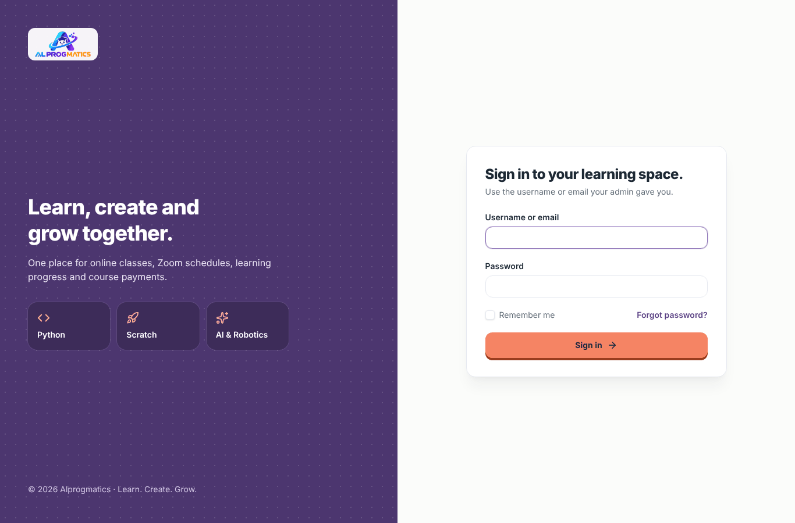
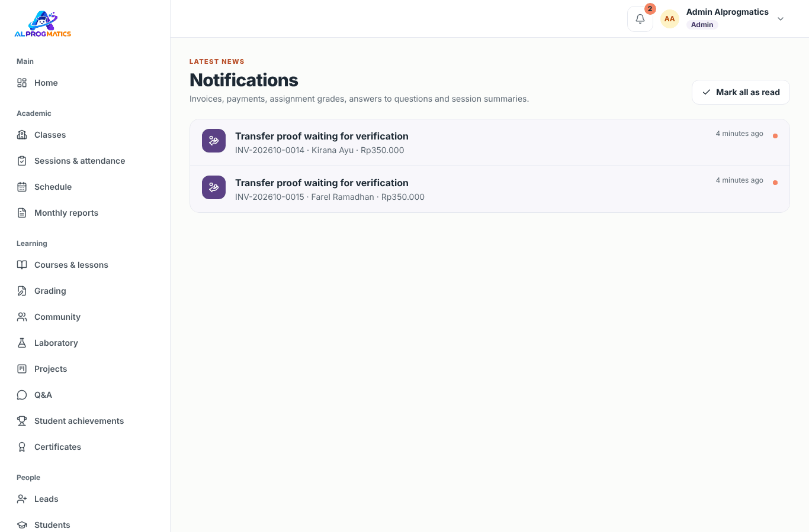

# Panduan Pengguna Alprogmatics LMS

Panduan ini menjelaskan cara memakai aplikasi untuk setiap peran. Pilih panduan sesuai akun Anda:

| Peran | Untuk siapa | Panduan |
|---|---|---|
| Admin | Pengelola kursus: calon siswa, data pengguna, kelas, jadwal, keuangan | [admin.md](admin.md) |
| Guru | Tutor yang mengajar kelas, membuat materi, menilai | [guru.md](guru.md) |
| Siswa | Anak yang belajar | [siswa.md](siswa.md) |
| Orang tua | Orang tua atau wali yang memantau anak dan membayar tagihan | [orang-tua.md](orang-tua.md) |

Tampilan aplikasi berbahasa Inggris. Di panduan ini, label menu dan tombol ditulis **tebal** persis seperti di layar, misalnya **Sign in** atau **Save**.

Untuk pemasangan di server, lihat [dokumentasi production](../production.md).

## Hal yang sama untuk semua peran

### Masuk (login)

1. Buka alamat aplikasi, lalu klik **Sign in** di halaman depan (atau langsung buka `/login`).
2. Isi **Username or email** dan **Password**. Anak tidak wajib punya email; cukup username yang dibuat admin. Centang **Remember me** bila memakai perangkat pribadi.
3. Klik **Sign in**. Anda akan diarahkan ke **Home**, yang isinya berbeda untuk tiap peran.

Catatan:

- Tidak ada pendaftaran akun mandiri. Semua akun dibuat oleh admin. Calon siswa bisa mendaftar kelas trial gratis di `/free-trial`; admin yang kemudian membuatkan akunnya.
- Akun berstatus **Inactive** tidak bisa login. Hubungi admin bila ini terjadi.
- **Forgot password?** mengirim tautan reset ke email akun (isi **Email**, lalu klik **Email password reset link**). Akun tanpa email (umumnya siswa) harus meminta admin mengganti kata sandinya.

### Navigasi

- **Menu samping** (sidebar) dikelompokkan menjadi **Main**, **Academic**, **Learning**, **People**, **Finance**, dan **Other**. Menu yang tampil disaring otomatis sesuai peran, jadi setiap peran melihat menu yang berbeda.
- Di HP, menu samping dibuka lewat tombol menu di kiri atas.
- **Lonceng** di kanan atas menampilkan notifikasi terbaru. Angka di atas lonceng menunjukkan jumlah notifikasi yang belum dibaca.
- **Menu akun** (nama dan peran Anda di kanan atas) berisi **My profile** dan **Sign out**.

### Profil dan kata sandi

Buka menu akun, pilih **My profile**. Di bagian **Profile information** Anda bisa mengubah **Name** dan **Email**, lalu **Save**. Di bagian **Change password**, isi **Current password**, **New password**, dan **Confirm password**, lalu **Save**.

### Notifikasi

Halaman **Notifications** (`/notifications`, juga bisa dibuka lewat **View all** di lonceng) berisi kabar yang relevan untuk Anda, misalnya:

| Peran | Contoh notifikasi |
|---|---|
| Admin | Bukti transfer baru dari orang tua, lead baru dari formulir trial, hasil kelas trial, siswa tertarik pada kursus lain |
| Guru | Pertanyaan baru dari siswa, pengingat laporan sesi yang belum diisi, jadwal kelas trial, laporan masalah pada materi |
| Siswa | PR dari sesi, tugas dinilai atau diminta revisi, jawaban atas pertanyaan |
| Orang tua | Tagihan baru, hasil verifikasi pembayaran, ringkasan sesi anak, laporan bulanan siap dibaca, anak tertarik pada kursus lain |

Klik notifikasi untuk membuka halaman terkait. Tombol **Mark all as read** menghapus tanda belum dibaca sekaligus. Notifikasi hanya muncul di dalam aplikasi; belum ada pengiriman lewat WhatsApp atau email.

### Jadwal di kalender HP

Halaman **Schedule** menampilkan sesi kelas per minggu (semua waktu dalam WIB). Di bagian bawahnya ada **Show the schedule in your phone calendar**:

1. Klik **Create calendar link**.
2. Klik **Copy link**, lalu tambahkan tautan itu (bentuknya `/calendar/{token}.ics`) sebagai kalender langganan. Google Calendar: *Add calendar → From URL*. iPhone: *Settings → Calendar → Accounts → Add Account → Other → Add Subscribed Calendar*. Outlook juga bisa.
3. Jadwal kelas beserta link Zoom akan muncul dan diperbarui otomatis di kalender HP.

Tautan ini bersifat pribadi. Bila tersebar, klik **Regenerate**; tautan lama langsung tidak berlaku.

### Masuk kelas Zoom

Setiap sesi punya tombol **Join Zoom** di **Home**, di halaman kelas, dan di halaman sesi. Link, Meeting ID, dan passcode diatur admin per kelas.

### Cek keaslian sertifikat

Setiap sertifikat punya kode verifikasi. Siapa pun (tanpa login) bisa membuka `/certificates/{kode}` untuk memastikan sertifikat itu asli dan belum dicabut.

### Istilah

| Istilah | Di aplikasi | Arti |
|---|---|---|
| Kelas | Class | Rombongan belajar dengan guru, jadwal mingguan, dan link Zoom |
| Sesi | Session | Satu pertemuan kelas pada tanggal tertentu, dibuat otomatis dari jadwal mingguan |
| Kursus | Course | Kurikulum berisi pelajaran (materi, kuis, tugas, soal coding) yang dipasang ke satu atau beberapa kelas |
| Pelajaran | Lesson | Satu isi kursus: materi bacaan/video, kuis, tugas, atau soal coding |
| Misi Pemanasan / Misi Akhir | Warm-up Mission / Final Mission | Kuis awal dan akhir kursus (pre-test dan post-test) untuk mengukur kenaikan kemampuan |
| Paket sesi | Session package | Paket berisi sejumlah sesi (mis. 8 sesi) yang dibayar di muka dan terpotong tiap sesi |
| Proyek | Project | Tugas berkarya langkah demi langkah dengan papan kanban per siswa |
| Laboratorium / Komunitas | Laboratory / Community | Tempat membuat proyek coding bebas, dan galeri proyek yang dibagikan ke semua siswa |
| Laporan bulanan | Monthly report | Rapor satu bulan: kehadiran, catatan guru, nilai, dan prestasi; bisa dicetak atau disimpan sebagai PDF |
| Lead | Lead | Calon siswa yang mendaftar kelas trial, sebelum punya akun |
| XP, level, lencana | XP, level, badges | Poin dan penghargaan yang dihitung otomatis dari aktivitas belajar |
