# Panduan Admin

Admin mengelola seluruh operasional: calon siswa (leads), akun pengguna, kelas dan jadwal, sesi, kurikulum, laporan bulanan, keuangan, dan honor tutor. Admin bisa membuka semua halaman, termasuk yang dipakai guru.

Baca dulu [hal yang sama untuk semua peran](README.md#hal-yang-sama-untuk-semua-peran) (login, menu, notifikasi, kalender).

Label tombol dan menu di panduan ini ditulis persis seperti di aplikasi (bahasa Inggris), misalnya **Students → Add student**.

## Urutan kerja yang disarankan saat mulai

1. Tambah **guru** (beserta honor per sesi).
2. Tambah **siswa**, lalu **orang tua** dan hubungkan ke anaknya. Calon siswa dari formulir trial bisa langsung dijadikan siswa dari menu **Leads**.
3. Buat **kelas** dengan jadwal mingguan dan link Zoom, lalu daftarkan siswa.
4. Buat **paket sesi** dan jual ke siswa (tagihan dibuat otomatis).
5. Guru (atau admin) membuat **kursus** dan memasangnya ke kelas.
6. Setiap awal bulan, pastikan catatan **laporan bulanan** sudah ditulis guru.
7. Setiap akhir bulan, rekap **honor tutor** menjadi slip.

## Beranda

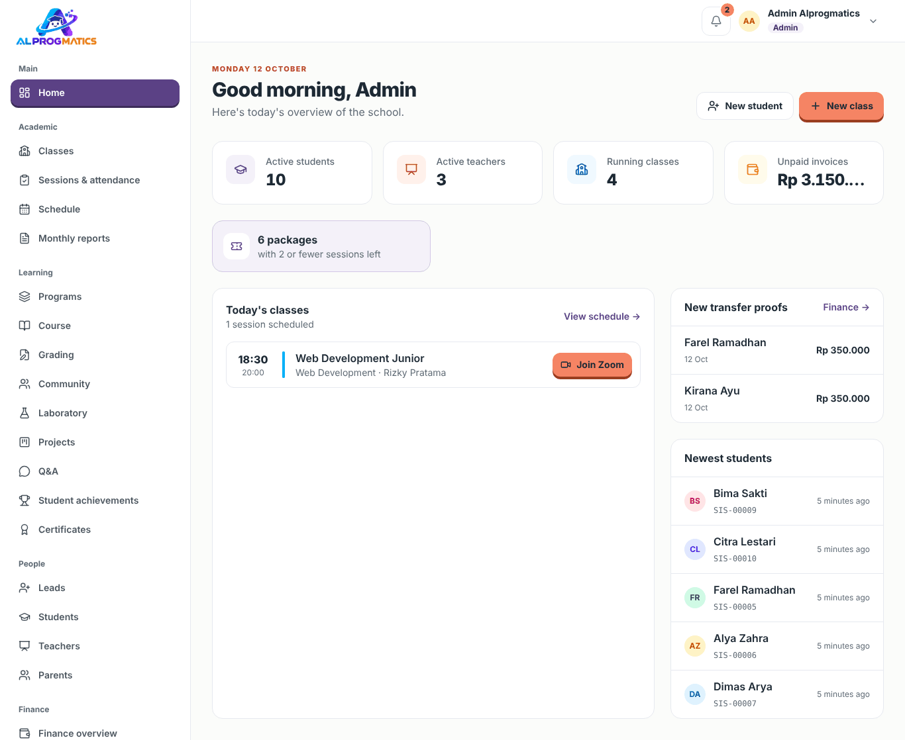

Menu **Home** untuk admin merangkum:

- **Active students**, **Active teachers**, **Running classes**, dan **Unpaid invoices** (total nominal yang belum terbayar).
- Kotak peringatan bila ada: sesi yang belum diisi absensinya (*without attendance yet*), sesi yang ditandai guru (*flagged sessions need follow-up*), dan paket dengan sisa kuota ≤ 2 sesi. Klik kotaknya untuk langsung membuka daftar terkait.
- **Today's classes**, dengan tombol **Join Zoom** dan tautan **View schedule**.
- **New transfer proofs** yang perlu diverifikasi.
- **Newest students**, serta tombol cepat **New student** dan **New class**.

## Leads dan kelas trial

Menu **Leads** (grup People) menampung calon siswa, dari pendaftaran kelas trial gratis sampai menjadi siswa.

### Dari mana leads masuk

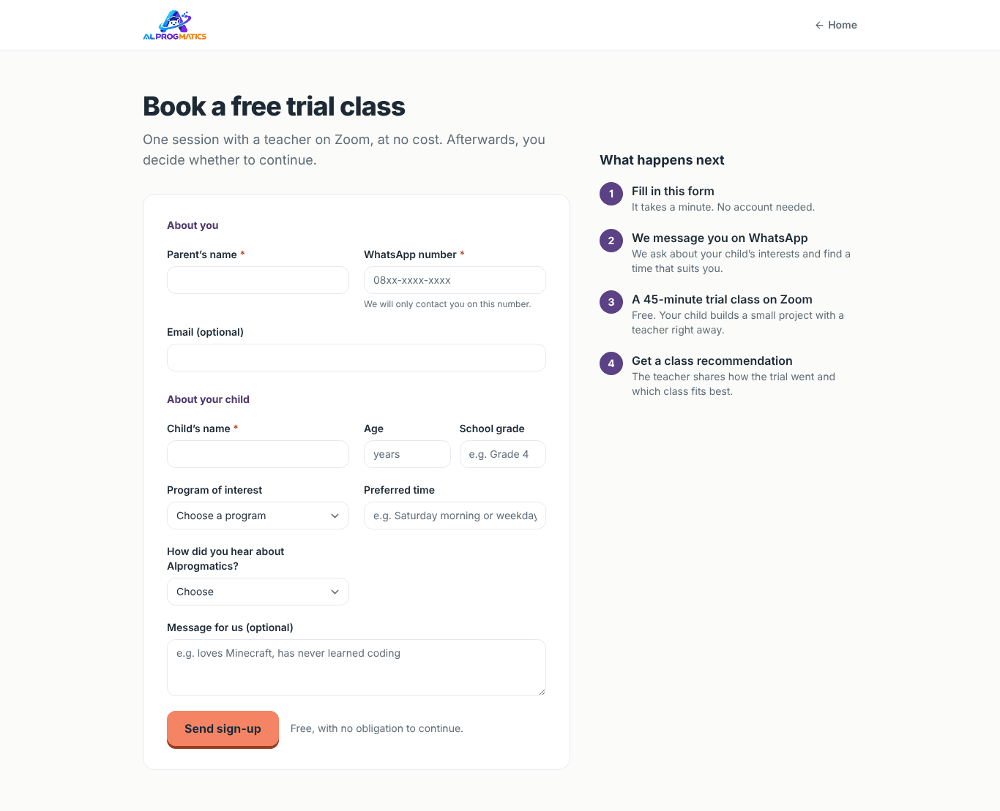

- **Formulir publik** di `/free-trial` (tombol **Try for free** / **Try a free class** di halaman depan). Orang tua mengisi data diri, data anak, **Program of interest**, **Preferred time**, dan sumber info, lalu klik **Send sign-up**. Tidak perlu akun. Formulir yang terkirim ulang dengan nomor dan nama anak yang sama dalam 24 jam tidak membuat lead ganda.
- **Tambah manual** untuk orang tua yang menghubungi lewat WhatsApp, telepon, atau datang langsung: **Leads → Add manually**, isi **Parent’s name**, **WhatsApp number**, **Child’s name**, dan data lain, lalu **Save**.

Setiap lead baru dari formulir memunculkan notifikasi **New lead** ke semua admin.

### Papan leads

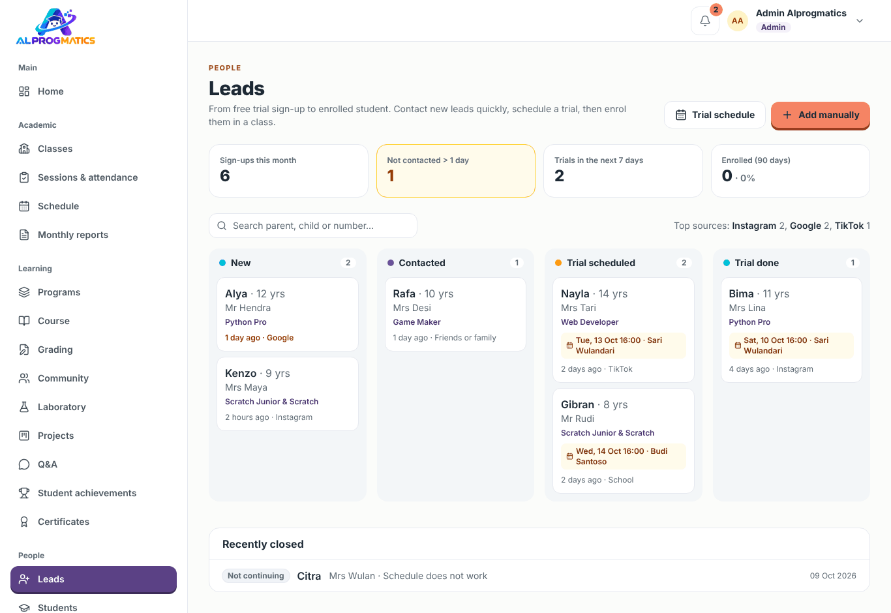

Bagian atas menampilkan **Sign-ups this month**, **Not contacted > 1 day** (berwarna kuning bila ada yang terlambat dihubungi), **Trials in the next 7 days**, dan **Enrolled (90 days)** beserta persentase konversi. Di bawahnya ada papan dengan kolom tahap **New**, **Contacted**, **Trial scheduled**, dan **Trial done**. Lead yang sudah selesai muncul di **Recently closed** sebagai **Enrolled** atau **Not continuing**.

Tombol **Trial schedule** membuka daftar semua kelas trial (halaman yang sama dengan menu **Trial classes** milik guru).

### Menindaklanjuti satu lead

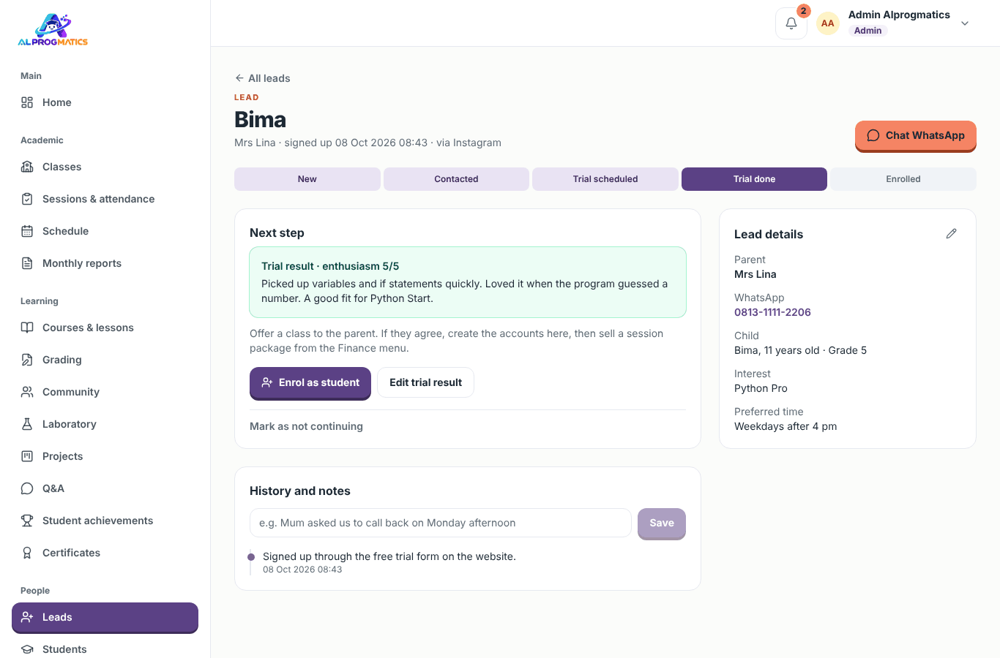

Klik kartu lead untuk membuka detailnya. Kotak **Next step** selalu menampilkan langkah berikutnya:

1. **New**: klik **Chat WhatsApp** (pesan pembuka sudah disiapkan), lalu **I have contacted them**. Bila waktu sudah disepakati, bisa langsung **Schedule a trial now**.
2. **Contacted**: klik **Schedule trial**, isi **Time**, **Teacher**, dan **Zoom link** (kosongkan bila guru memakai link pribadinya), lalu **Save schedule**. Guru menerima notifikasi.
3. **Trial scheduled**: sehari sebelumnya, kirim pengingat lewat **Chat WhatsApp** (pesan otomatis berisi jadwal dan link Zoom). Bila perlu, **Reschedule**. Setelah trial, guru mengisi hasilnya; admin juga bisa lewat **Record trial result** (isi **How did the trial go?**, **Child’s enthusiasm (1–5)**, dan **Recommended class**). Admin mendapat notifikasi saat hasil trial masuk.
4. **Trial done**: tawarkan kelas ke orang tua. Bila setuju, klik **Enrol as student**, isi **Child’s username**, **Parent’s username**, **Initial password**, **Relationship**, dan **Enrol in class** (boleh **Later**), lalu **Create accounts**. Akun anak dan orang tua dibuat dengan kata sandi yang sama; kirimkan ke orang tua dan minta mereka menggantinya. Bila nomor WhatsApp sudah terdaftar sebagai orang tua (misalnya kakaknya sudah belajar di sini), anak ditambahkan ke akun orang tua tersebut.
5. Setelah **Enrolled**, klik **Sell session package** untuk menjual paket (lihat [Paket sesi](#paket-sesi)).

Tautan **Enrol as student now** tersedia di tahap mana pun bila orang tua langsung mendaftar tanpa trial. Bila calon siswa tidak lanjut, klik **Mark as not continuing** dan isi **Reason** (tersedia pilihan seperti *No reply* atau *Price does not work*). Lead yang ditutup bisa dibuka lagi dengan **Reopen**.

Bagian **History and notes** mencatat setiap perubahan tahap secara otomatis. Tambahkan catatan sendiri (mis. "Minta ditelepon Senin sore") lalu **Save**. Data lead bisa diubah dengan ikon pensil di **Lead details**.

## Pengguna

Grup menu **People** berisi **Leads**, **Students**, **Teachers**, dan **Parents**. Setiap akun punya username untuk login, email opsional (tetapi diperlukan untuk reset kata sandi mandiri), dan **Account status** **Active** atau **Inactive (cannot log in)**.

### Siswa

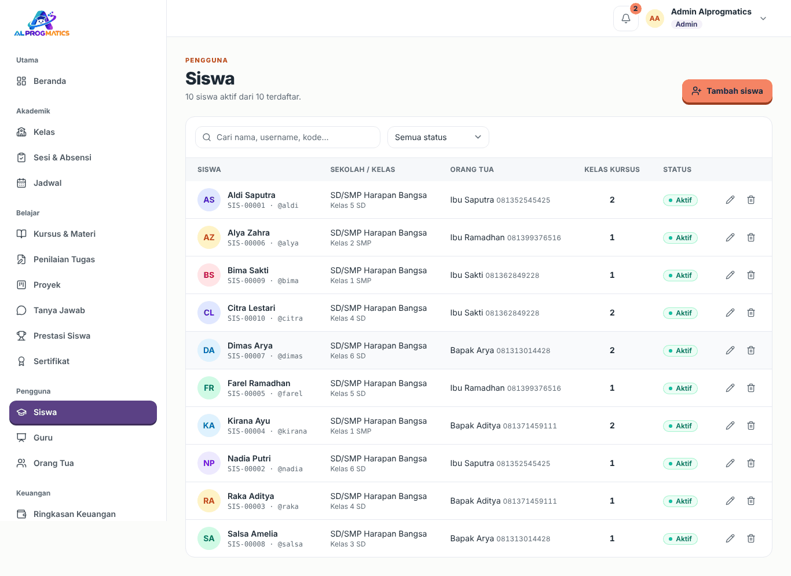

1. Buka **Students → Add student**.
2. **Login account**: **Full name**, **Username** (huruf kecil, angka, `-` atau `_`), **Email** (opsional), **Phone / WhatsApp**, **Account status**, **Password** (minimal 8 karakter). Anak bisa login dengan username tanpa email.
3. **Student details**: **Date of birth**, **Gender**, **School**, **School grade**, **Join date**, **Address**, **Notes**.
4. **Parents / guardians**: centang orang tua yang sudah ada, atau klik **Add parent**.
5. Klik **Save**. Kode siswa dibuat otomatis (`SIS-00001`, dst.).

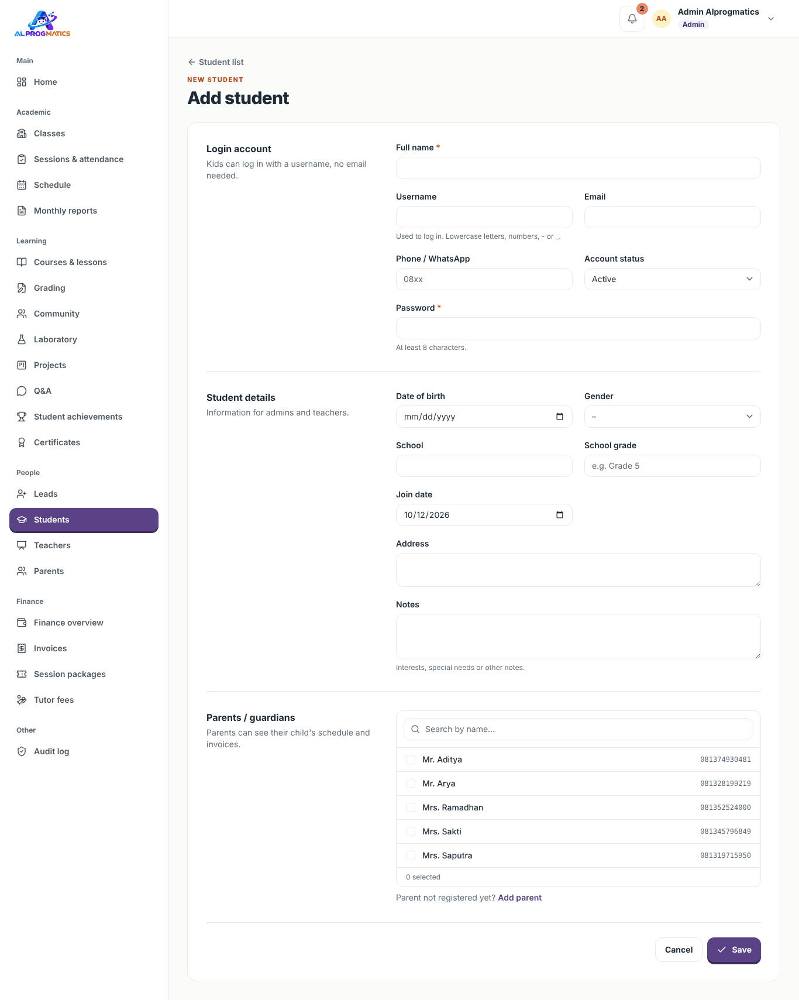

Gunakan kotak cari dan filter status (**All statuses**/**Active**/**Inactive**) di daftar. Ikon hapus (**Delete**) menonaktifkan akun dan menyembunyikannya dari daftar; riwayat belajar dan keuangannya tetap tersimpan.

**Mengganti kata sandi siswa yang lupa**: klik ikon pensil (**Edit**) pada siswa tersebut, isi **Password** baru, lalu **Save**. Kosongkan kolom ini bila tidak ingin mengganti kata sandi.

### Guru

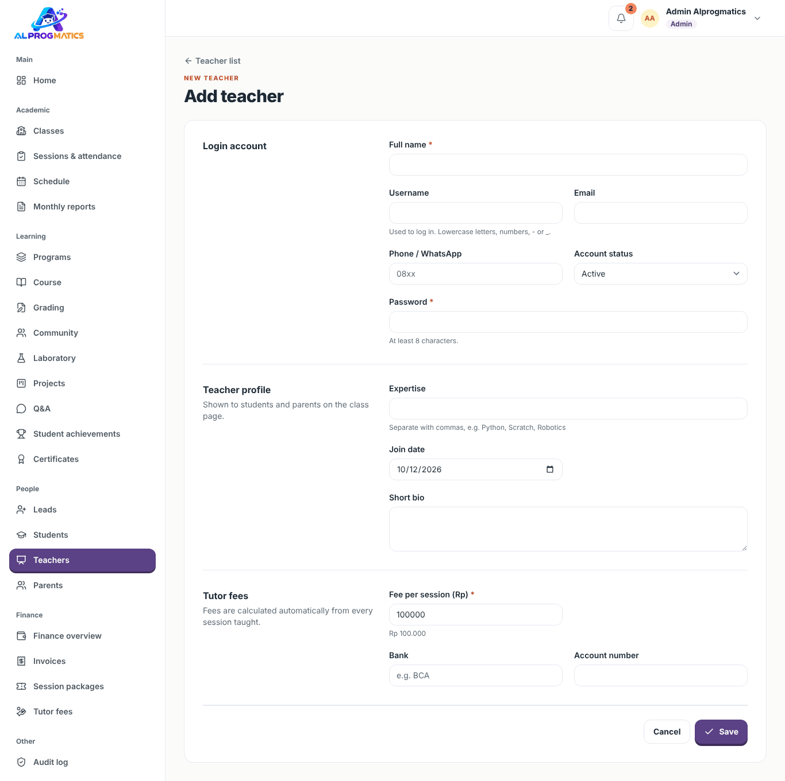

1. **Teachers → Add teacher**.
2. Isi **Login account**, lalu **Teacher profile**: **Expertise** (pisahkan dengan koma), **Join date**, dan **Short bio** yang tampil ke siswa dan orang tua di halaman kelas.
3. Bagian **Tutor fees**: isi **Fee per session (Rp)**, **Bank**, dan **Account number**. Honor dihitung otomatis dari setiap sesi yang selesai diajar.
4. **Save**. Kode guru dibuat otomatis (`GRU-0001`).

Guru yang masih mengajar kelas berstatus **Running** tidak bisa dihapus; pindahkan dulu kelasnya ke guru lain.

### Orang tua

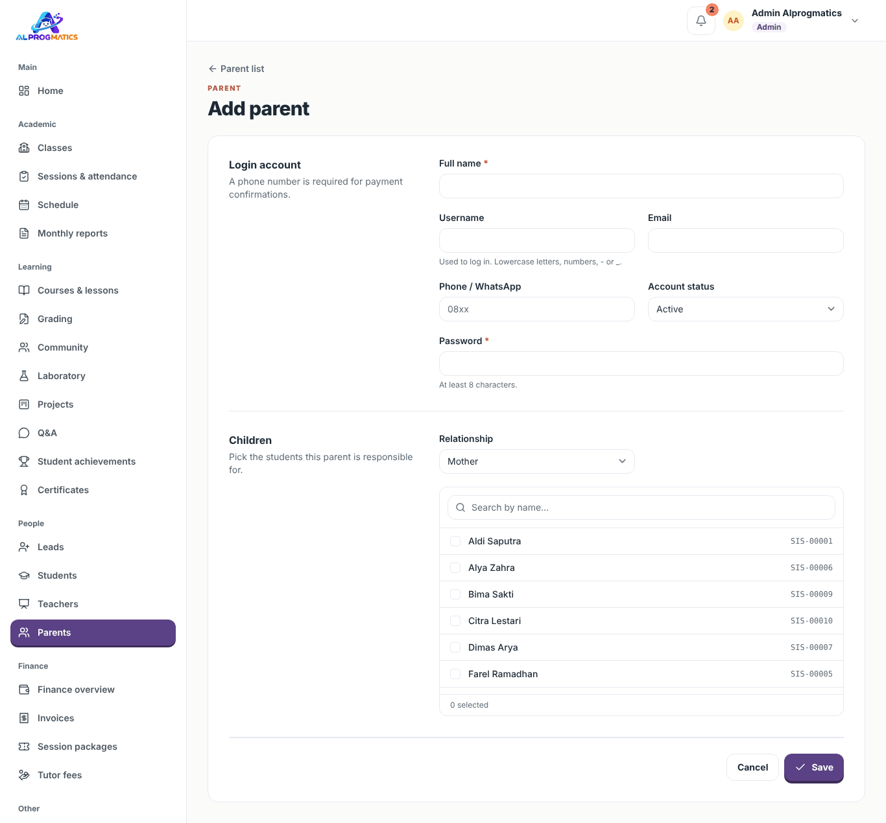

1. **Parents → Add parent**.
2. Isi **Login account**. **Phone / WhatsApp wajib** diisi untuk konfirmasi pembayaran.
3. Di bagian **Children**, pilih **Relationship** (**Father**/**Mother**/**Guardian**) dan centang siswa yang menjadi tanggungannya. Satu orang tua bisa punya beberapa anak.
4. **Save**. Orang tua kini bisa melihat jadwal, progres, laporan bulanan, proyek, prestasi, sertifikat, dan tagihan anaknya.

## Kelas dan jadwal

### Membuat kelas

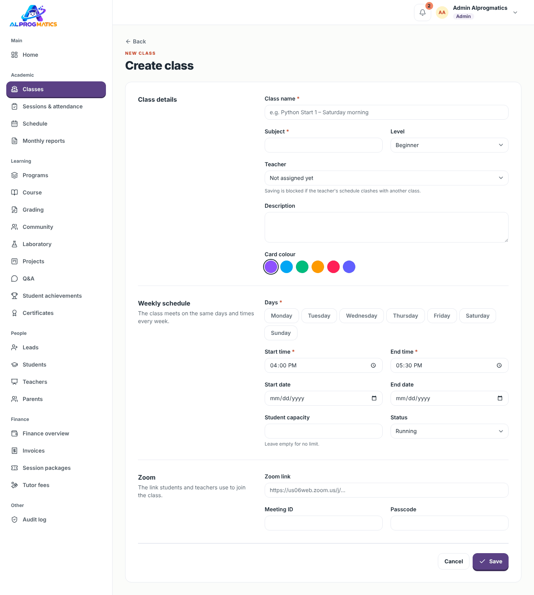

1. **Classes → Create class** (atau **New class** di Beranda).
2. **Class details**: **Class name** (mis. "Python Start 1 – Saturday morning"), **Subject**, **Level** (**Beginner**/**Intermediate**/**Advanced**), **Teacher**, **Description**, **Card colour**.
3. **Weekly schedule**: **Days**, **Start time**, **End time**, **Start date** dan **End date**, **Student capacity** (kosongkan bila tanpa batas), **Status** (**Upcoming**/**Running**/**Finished**).
4. **Zoom**: **Zoom link**, **Meeting ID**, **Passcode**.
5. **Save**. Sistem menolak jadwal yang bentrok dengan kelas lain milik guru yang sama.

### Mendaftarkan siswa ke kelas

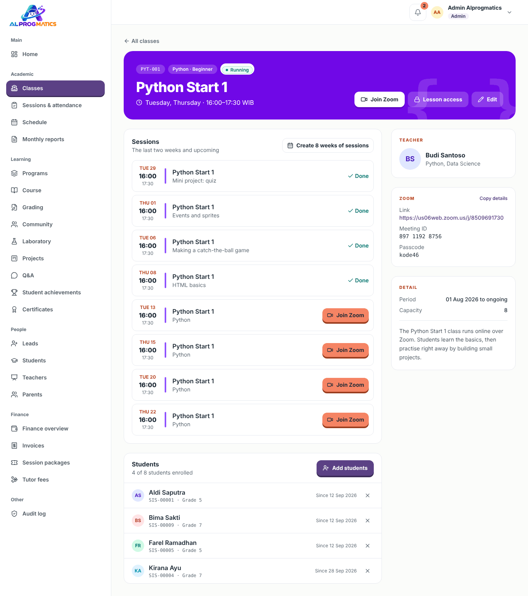

1. Buka kelas dari daftar **Classes**.
2. Di bagian **Students**, klik **Add students**, centang siswa aktif yang belum terdaftar, lalu klik **Add**.
3. Untuk mengeluarkan siswa, klik ikon silang (**Remove from class**) di baris siswa tersebut, lalu **Yes, remove**.

Daftar siswa kelas hanya terlihat oleh guru kelas dan admin. Tombol **Edit** di bagian atas halaman kelas membuka form kelas.

### Sesi dibuat otomatis

Sesi (pertemuan per tanggal) dibuat otomatis dari jadwal mingguan untuk empat minggu ke depan: saat kelas disimpan atau jadwalnya diubah, dan setiap malam. Bila perlu lebih jauh, buka detail kelas dan klik **Create 8 weeks of sessions**.

### Jadwal mingguan

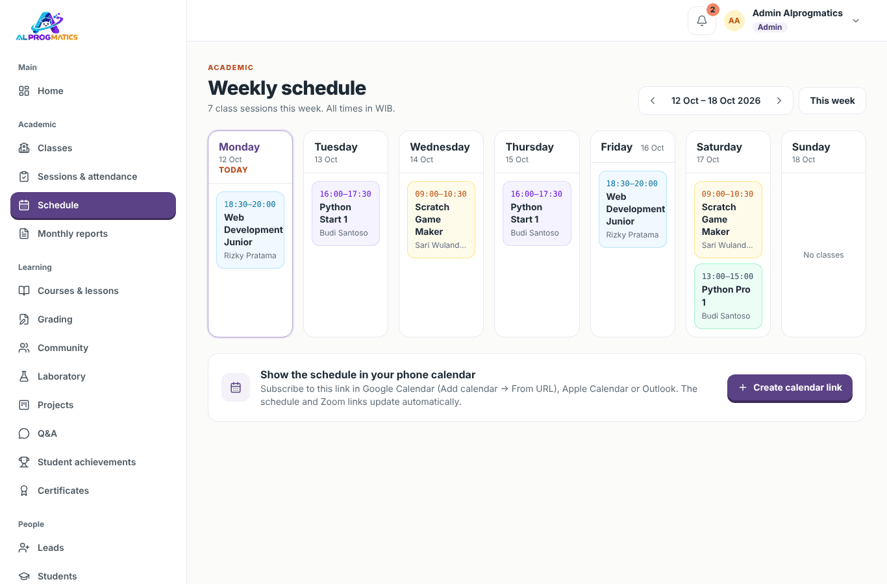

Menu **Schedule** (halaman **Weekly schedule**) menampilkan semua sesi minggu ini per hari, dalam WIB. Gunakan panah untuk pindah minggu atau **This week** untuk kembali. Tanda centang menandai sesi yang sudah selesai, titik kuning menandai sesi yang **absensinya belum diisi**, dan sesi yang batal atau dipindah tampil dicoret. Klik sesi untuk membuka detailnya.

## Sesi dan absensi

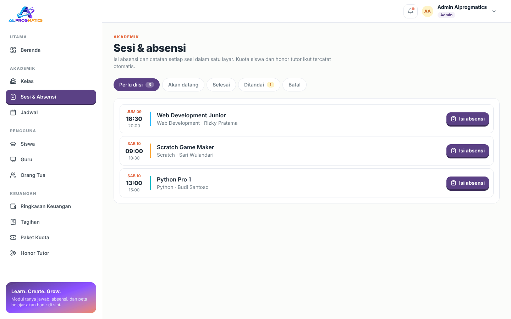

Menu **Sessions & attendance** berisi tab **Needs report**, **Upcoming**, **Completed**, **Flagged**, dan **Cancelled**. Biasanya guru yang mengisi laporan sesi (lihat [panduan guru](guru.md#mengisi-absensi-dan-catatan-sesi)), tetapi admin juga bisa: isi **Attendance** (**Present**/**Excused**/**Sick**/**Absent**), **Session notes**, lalu **Save & complete session**.

Tindakan admin pada halaman sesi:

- **Cancel session** untuk sesi berstatus **Scheduled** (isi **Reason**, mis. "Public holiday"). Kuota siswa tidak terpotong dan honor tidak dihitung.
- **Reschedule** sesi terjadwal, atau **Create replacement session** untuk sesi yang dibatalkan. Isi **Date**, **Start**, **End**, dan **Reason**, lalu **Save new time**. Sesi baru memakai guru dan link Zoom yang sama, tertaut ke sesi asal (**Replacement session** / **Replaces the session on**), dan sistem mengecek bentrok jadwal guru. Setiap sesi hanya bisa dipindah atau diganti sekali. Guru juga bisa memindah jadwal sesinya sendiri.
- Sesi yang guru beri tanda **Flag for admin** berarti ada kendala yang perlu ditindaklanjuti. Sesi ini muncul di tab **Flagged** dan sebagai peringatan di Beranda.

## Kursus, materi, dan penilaian

Admin memiliki akses yang sama dengan guru untuk **Courses & lessons**, **Grading** (termasuk **Reported problems**, yaitu laporan siswa tentang materi yang keliru), **Projects**, **Q&A**, **Student achievements**, dan **Certificates**. Langkah-langkahnya ada di [panduan guru](guru.md).

## Laporan bulanan

Menu **Monthly reports** (grup Academic) berisi rapor bulanan setiap siswa: kehadiran, pelajaran yang diselesaikan, nilai kuis dan tugas, latihan coding dan proyek, XP dan prestasi, progres kursus, serta paket sesi dan tagihan yang belum lunas.

1. Pilih bulan di kanan atas. Pada tujuh hari pertama setiap bulan, yang terbuka otomatis adalah bulan sebelumnya.
2. Cari siswa atau saring per kelas. Kolom **Teacher notes** menunjukkan berapa catatan kelas yang belum ditulis (*not written yet*) atau **Complete**.
3. Klik **Open** untuk membuka laporan. Di bagian **Note for parents** per kelas, isi **Going well** dan **Focus for next month**, lalu **Save note**. Guru menulis catatan untuk kelasnya sendiri; admin bisa menulis atau melengkapi catatan untuk kelas mana pun.
4. **Print / save PDF** untuk mencetak atau menyimpan laporan.

Setiap tanggal 1 pukul 08.00, orang tua menerima notifikasi bahwa laporan bulan lalu sudah bisa dibaca. Pastikan catatan guru sudah lengkap sebelum itu.

## Laboratorium dan Komunitas

**Laboratory** adalah tempat membuat proyek coding bebas; admin juga bisa membuat proyek sendiri lewat **New project**. **Community** menampilkan proyek yang dibagikan siswa ke semua kelas. Admin dan guru bertugas memoderasinya:

- **Menyembunyikan proyek**: buka proyek dari **Community**, klik **Remove from Community**, lalu **Remove**. Proyek tetap ada di Laboratory pemiliknya, tetapi tidak terlihat orang lain dan tidak bisa dibagikan ulang. Untuk mengembalikannya, buka proyek itu dan klik **Put it back**.
- **Menghapus komentar**: klik ikon hapus (**Delete comment**) pada komentar yang tidak pantas, lalu **Delete**.

## Keuangan

Pembayaran dilakukan orang tua lewat **transfer bank manual**. Tidak ada payment gateway. Alurnya: admin membuat tagihan → orang tua transfer dan mengunggah bukti → admin memverifikasi → status tagihan berubah otomatis.

### Ringkasan keuangan

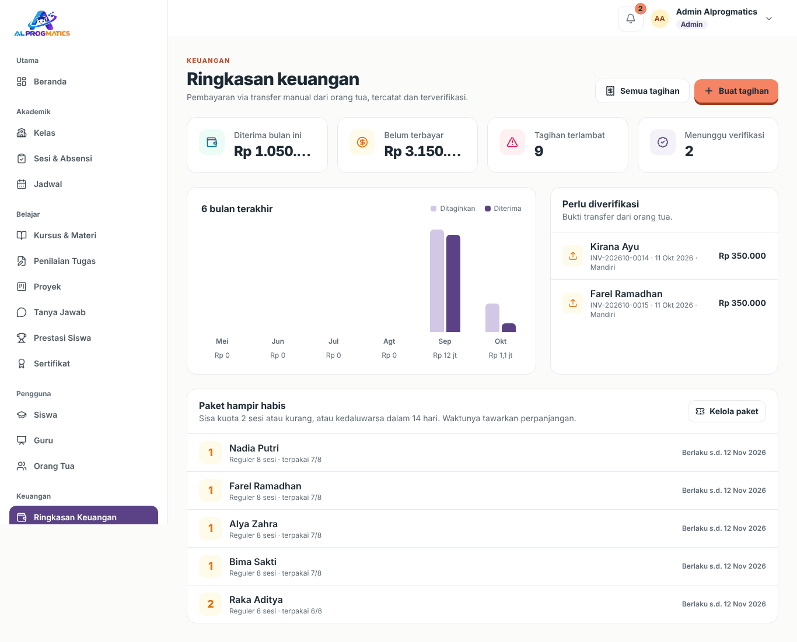

Menu **Finance overview** menampilkan **Received this month**, **Outstanding**, **Overdue invoices**, **Awaiting verification**, grafik **Billed** vs **Received** 6 bulan terakhir (**Last 6 months**), daftar **Needs verification**, dan **Packages running low** (sisa ≤ 2 sesi atau kedaluwarsa ≤ 14 hari). Gunakan daftar terakhir untuk menawarkan perpanjangan.

### Membuat tagihan

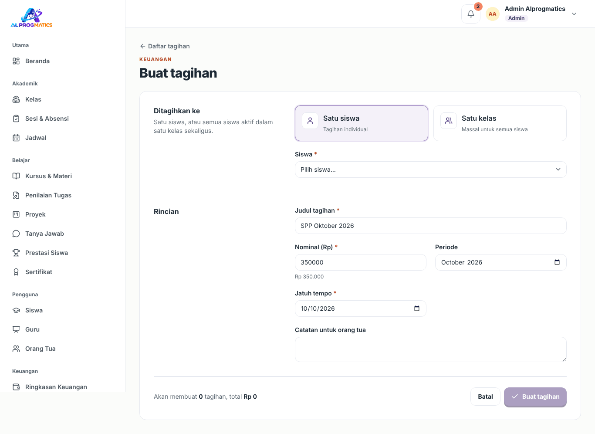

1. **Invoices → New invoice**.
2. **Bill to**: **One student**, atau **A whole class** (satu tagihan untuk setiap siswa aktif di kelas itu).
3. **Details**: **Invoice title** (mis. "Tuition October 2026"), **Amount (Rp)**, **Period**, **Due date**, **Note for parents**.
4. Klik **Create invoice**. Orang tua menerima notifikasi.

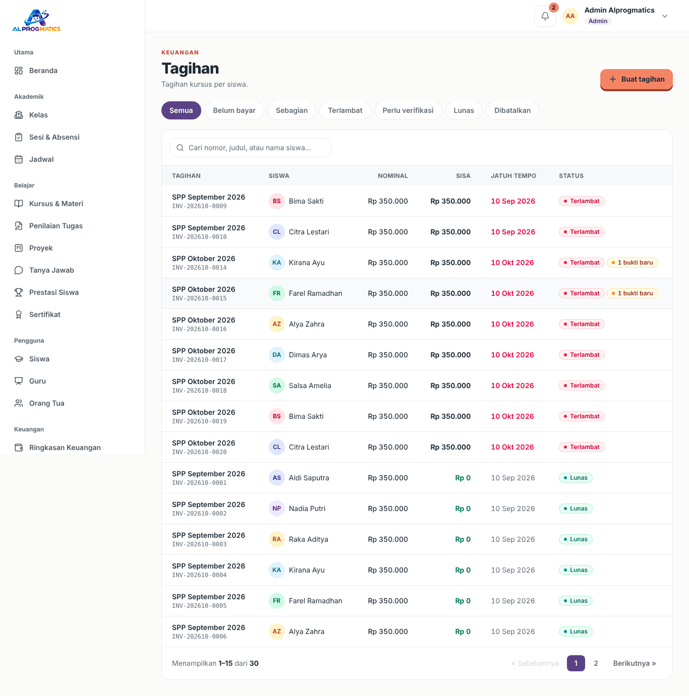

Tab status: **All**, **Unpaid**, **Partially paid**, **Overdue**, **Needs verification**, **Paid**, **Cancelled**. Tagihan dengan label *new proof(s)* berisi pembayaran yang menunggu verifikasi. Tagihan **Unpaid** yang belum ada pembayarannya bisa dibatalkan dengan **Cancel invoice** (tidak dihapus, demi jejak keuangan).

### Memverifikasi pembayaran

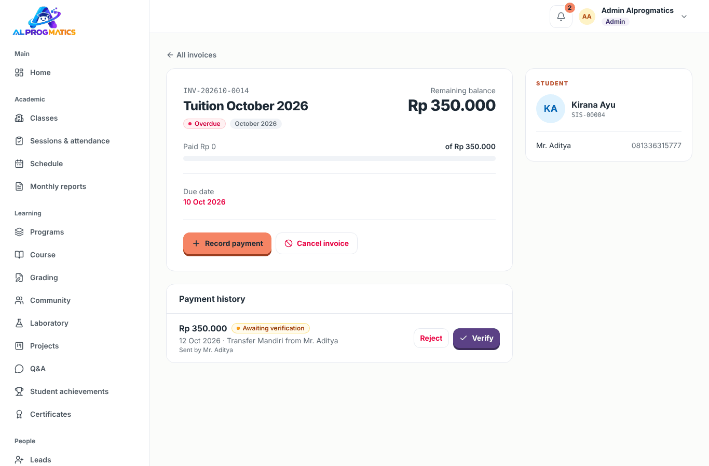

1. Buka tagihan dari **Needs verification** atau daftar tagihan.
2. Di **Payment history**, klik **Proof** untuk melihat bukti transfer, lalu cocokkan dengan mutasi rekening.
3. Klik **Verify** bila sesuai. Bila tidak, klik **Reject** dan isi **Reason** (terlihat oleh orang tua, mis. "Amount does not match the bank statement").
4. Status tagihan menjadi **Partially paid** atau **Paid** otomatis. Orang tua mendapat notifikasi hasilnya.

Untuk pembayaran tunai atau transfer yang dikonfirmasi lewat jalur lain, gunakan **Record payment** di halaman tagihan, pilih **Method** (**Bank transfer**/**Cash**), lalu **Save**. Bukti boleh dikosongkan, dan pembayaran yang dicatat admin langsung terverifikasi.

### Kuitansi

Tagihan dengan pembayaran terverifikasi punya tombol **Receipt** (`/finance/invoices/{id}/receipt`): halaman siap cetak lengkap dengan nominal terbilang (dalam bahasa Inggris). Klik **Print / save as PDF**.

### Paket sesi

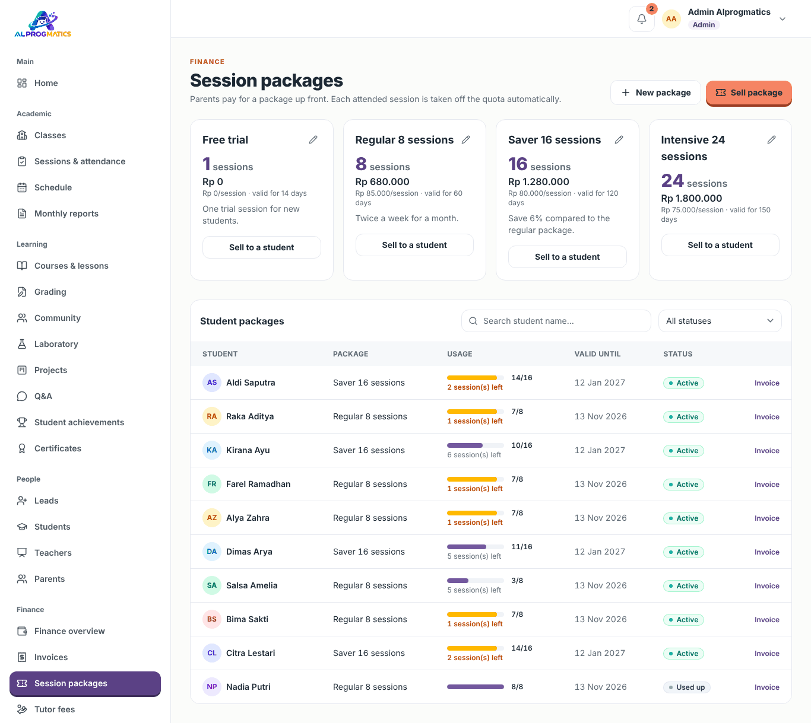

Menu **Session packages** berisi paket sejumlah sesi yang dibayar di muka.

1. **New package**: **Package name** (mis. "Regular 8 sessions"), **Number of sessions**, **Valid for (days)**, **Price (Rp)** (isi 0 untuk kelas trial gratis), **Description**, dan centang **For sale**. Paket yang tidak dijual tampil sebagai *Not for sale*.
2. **Sell package** (atau **Sell to a student** di kartu paket): pilih **Package**, **Student**, opsional **Only for class** (biarkan **All classes** agar berlaku untuk semua kelas siswa), dan **Invoice due date**, lalu **Create package**. Tagihan dibuat otomatis.
3. Paket berstatus **Awaiting payment** sampai tagihannya **Paid**, lalu menjadi **Active**. Centang **Activate now without waiting for payment** bila paket perlu langsung aktif. Paket seharga 0 langsung aktif tanpa tagihan.
4. Setiap sesi selesai, kuota terpotong otomatis: **Present** dan **Absent** memotong, **Excused** dan **Sick** tidak.
5. Paket berakhir sebagai **Used up** atau **Expired**. Paket yang belum terpakai sama sekali bisa dibatalkan lewat **Cancel** di kolom aksi.

Filter **Running low** membantu menemukan siswa yang perlu perpanjangan.

### Honor tutor

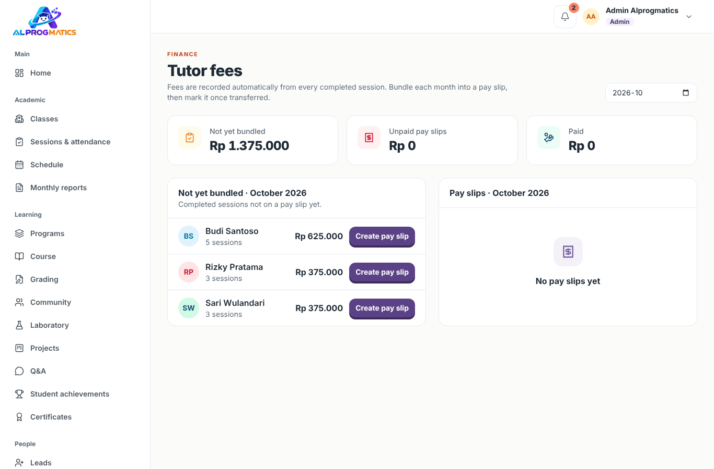

Honor tercatat otomatis setiap guru menyelesaikan sesi, sesuai **Fee per session** di profil guru.

1. Buka **Tutor fees** dan pilih bulan di kanan atas. Bagian **Not yet bundled** menampilkan sesi selesai yang belum masuk slip, per guru.
2. Klik **Create pay slip** pada guru, isi **Bonus (Rp)**, **Deduction (Rp)**, dan **Notes** bila ada, lalu **Create pay slip**. Sesi-sesi tersebut masuk ke slip.
3. Buka slip dari daftar **Pay slips**, klik **Mark as paid** setelah transfer, isi **Transfer date** dan unggah **Transfer proof** (opsional), lalu **Save**.
4. Slip bisa dicetak dengan **Print**. Slip yang belum dibayar bisa dihapus dengan **Delete**; sesinya kembali ke daftar *not yet bundled*.

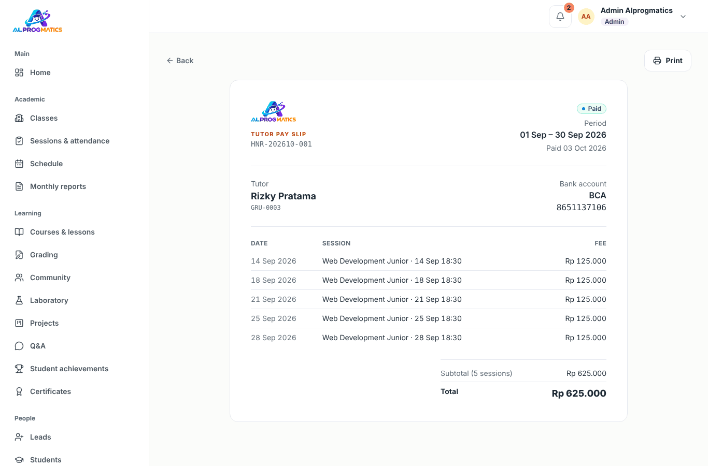

Guru melihat slipnya sendiri di menu **My fees**.

## Audit log

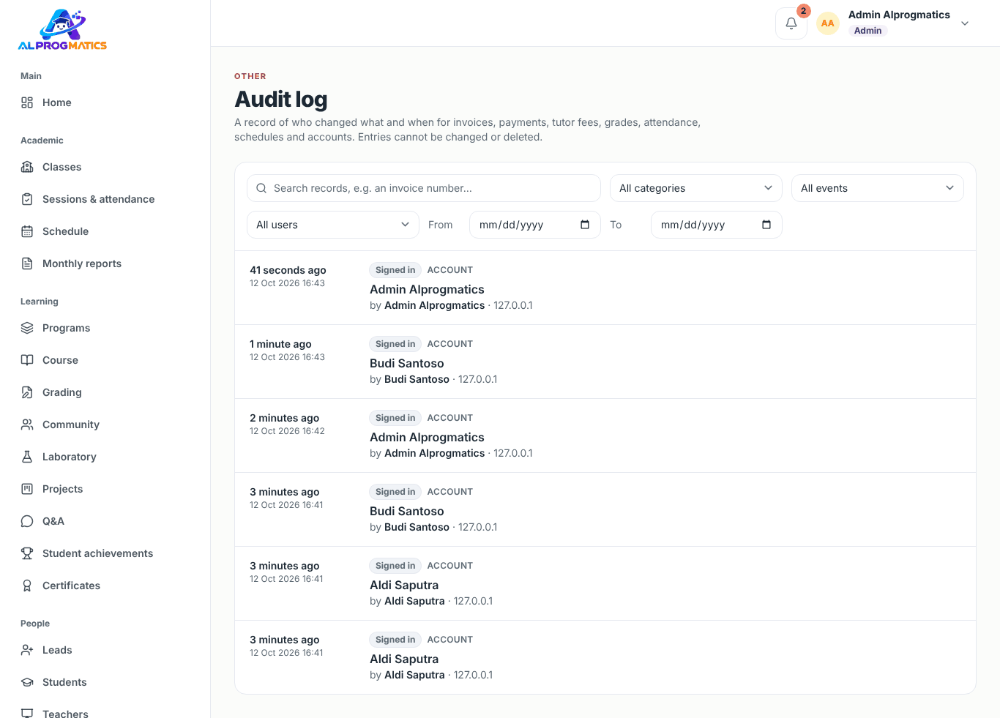

Menu **Audit log** (grup Other, khusus admin) mencatat siapa mengubah apa dan kapan untuk data penting: akun dan honor guru, tagihan, pembayaran, paket sesi, slip honor, nilai tugas, absensi, jadwal kelas dan sesi, sertifikat, dan leads. Login berhasil dan gagal juga dicatat. Catatan tidak bisa diubah atau dihapus.

- Saring dengan kotak cari (mis. nomor tagihan), **All categories**, **All events** (**Created**, **Updated**, **Deleted**, **Signed in**, **Failed sign-in**), **All users**, serta tanggal **From** dan **To**. **Clear filters** mengembalikan semua filter.
- Setiap entri menampilkan nilai lama (dicoret) dan nilai baru, pelakunya, dan alamat IP.
- Bila ada 5 atau lebih percobaan login gagal dalam 24 jam, muncul peringatan di bagian atas. Periksa apakah ada yang mencoba menebak kata sandi.

## Hal yang perlu diketahui admin

- Admin lolos semua cek hak akses, tetapi aturan bisnis tetap berlaku (mis. tagihan lunas tidak bisa dibayar lagi, sesi yang sudah dipindah tidak bisa dipindah lagi).
- Notifikasi saat ini hanya muncul di dalam aplikasi (lonceng). Pengiriman lewat WhatsApp atau email belum tersedia; pesan WhatsApp ke calon siswa dikirim manual lewat tombol **Chat WhatsApp**.
- Rekening tujuan transfer yang tampil ke orang tua diatur di konfigurasi server (`FINANCE_BANK_*`), bukan dari menu. Lihat [dokumentasi production](../production.md#konfigurasi-env).
- Isi halaman depan (kontak, harga, testimoni) diatur di kode, bukan dari menu. Lihat [dokumentasi production](../production.md#menyesuaikan-halaman-depan).
