# Panduan Guru

Guru mengajar kelas lewat Zoom, mengisi absensi dan catatan setiap sesi, membuat kursus beserta materi, kuis, tugas, dan soal coding, menindaklanjuti laporan masalah dari siswa, menjawab pertanyaan siswa, membimbing proyek, menulis catatan rapor bulanan, mengajar kelas percobaan (trial), serta menerbitkan sertifikat.

Baca dulu [hal yang sama untuk semua peran](README.md#hal-yang-sama-untuk-semua-peran) (login, notifikasi, kalender HP).

Menu guru di sidebar:

| Grup | Menu |
| --- | --- |
| Main | **Home** |
| Academic | **Classes**, **Online Lesson**, **Schedule**, **Monthly reports**, **Trial classes** |
| Learning | **Course**, **Grading**, **Community**, **Laboratory**, **Projects**, **Q&A**, **Student achievements**, **Certificates** |
| Finance | **My fees** |

## Beranda

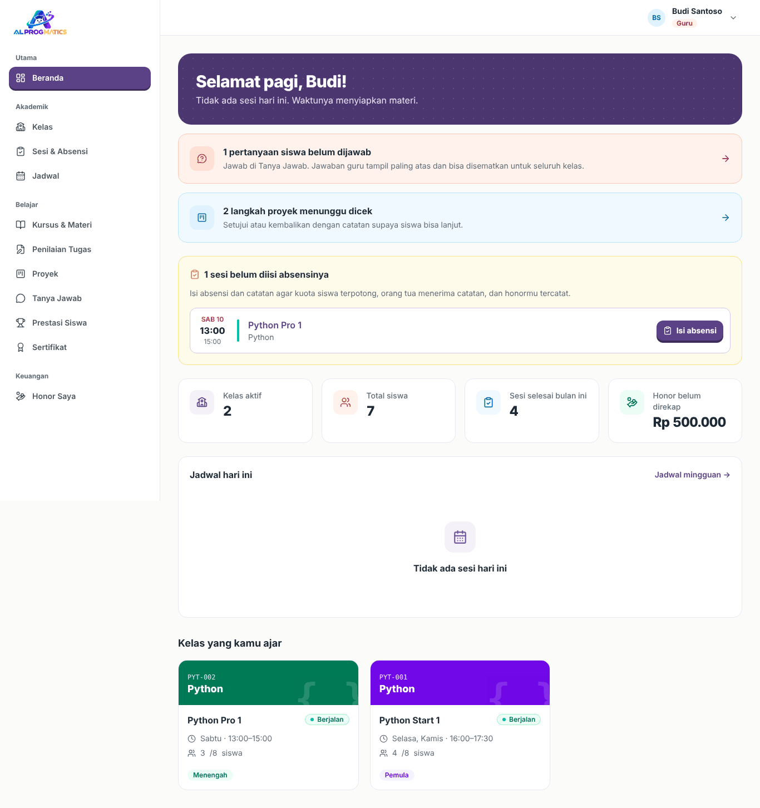

Beranda (**Home**) guru berisi:

- Kartu tugas yang menunggu Anda (hanya muncul bila ada): tugas siswa yang perlu dinilai (**... waiting to be graded**), pertanyaan yang belum dijawab (**... not answered yet**), langkah proyek yang perlu dicek (**... waiting for review**), dan sesi yang belum diisi absensinya (**... without attendance yet**) dengan tombol **Take attendance**.
- **Active classes**, **Total students**, **Sessions done this month**, **Fees not yet paid out**.
- **Today's schedule** dengan tombol **Join Zoom**, serta tautan **Weekly schedule**.
- **Classes you teach**.

## Kelas dan jadwal

- Menu **Classes** menampilkan kelas yang Anda ajar. Buka kelas untuk melihat daftar siswa (**Students**), link dan passcode **Zoom**, serta **Sessions** dua minggu terakhir dan yang akan datang.
- Menu **Schedule** menampilkan sesi per minggu. Pasang jadwal ke kalender HP lewat **Create calendar link** (lihat [panduan umum](README.md#jadwal-di-kalender-hp)).
- Kelas, jadwal mingguan, dan daftar siswa diatur oleh admin.

## Mengisi absensi dan catatan sesi

Ini tugas terpenting setelah mengajar. Saat Anda menyelesaikan sesi, kuota paket siswa terpotong, orang tua menerima catatan, PR terkirim ke siswa, dan honor Anda tercatat.

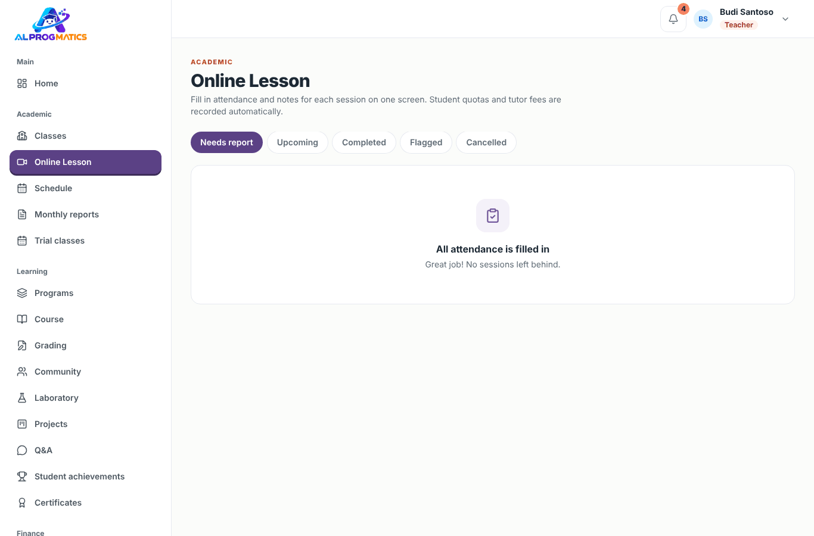

1. Buka **Online Lesson**, lalu pilih sesi (atau klik **Take attendance** dari Beranda). Tab yang tersedia: **Needs report**, **Upcoming**, **Completed**, **Flagged**, **Cancelled**.
2. Di **Attendance**, pilih status setiap siswa: **Present**, **Excused**, **Sick**, atau **Absent**. Tombol **Mark all present** mempercepat. Keterangan per siswa (**Note (optional)**) muncul bila status bukan **Present**.
3. Di **Session notes**, isi:
   - **Topic covered** (wajib), mis. "for and while loops".
   - **Homework**: dikirim sebagai notifikasi ke siswa.
   - **Note for parents**: terlihat di portal orang tua.
   - **Internal note**: hanya untuk admin dan guru.
   - **Zoom recording link** (opsional).
   - Centang **Flag for admin** bila ada kendala (siswa kesulitan, masalah teknis) yang perlu ditindaklanjuti.
4. Klik **Save & complete session**.

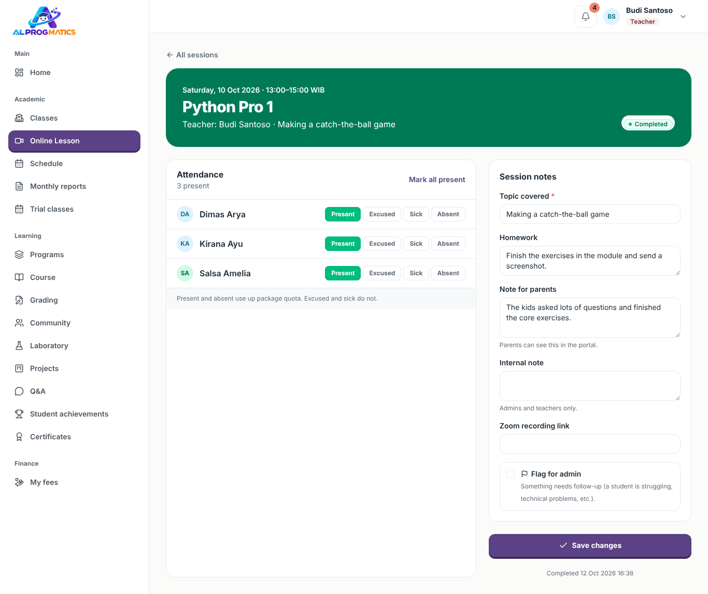

Catatan:

- **Present** dan **Absent** memotong kuota paket siswa. **Excused** dan **Sick** tidak.
- Laporan bisa diubah lagi setelah selesai (tombol berubah menjadi **Save changes**).
- Bila laporan belum diisi sekitar dua jam setelah sesi berakhir, Anda mendapat notifikasi pengingat.

### Pindah jadwal dan sesi pengganti

Bila sesi harus digeser (mis. siswa ujian sekolah), buka sesi itu dan klik **Reschedule**. Isi **Date**, **Start**, **End**, dan **Reason**, lalu **Save new time**.

- Sesi lama berstatus **Rescheduled** dan menampilkan tautan **Replacement session**. Sesi baru menampilkan **Replaces the session on ...**. Sesi baru memakai guru dan link Zoom yang sama.
- Kuota siswa tidak terpotong untuk sesi lama.
- Sistem menolak jadwal yang sudah lewat, yang bentrok dengan kelas Anda yang lain, atau yang sama persis dengan sesi lain di kelas itu.
- Setiap sesi hanya bisa dipindah satu kali. Untuk menggeser lagi, pindahkan sesi penggantinya.
- Pembatalan sesi (**Cancel session**) dilakukan oleh admin. Untuk sesi yang sudah dibatalkan, Anda bisa membuat sesi pengganti (*make-up*) lewat tombol **Create replacement session** dengan isian yang sama.

## Kursus dan materi

Kursus adalah kurikulum yang bisa dipakai beberapa kelas sekaligus. Setiap kelas memakai satu kursus. Siswa melihat kursus yang dipasang ke kelasnya dan berstatus **Published**.

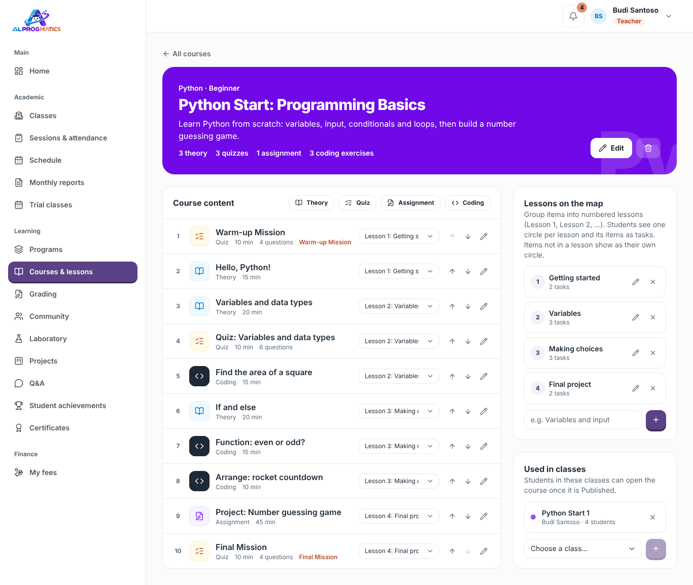

### Program, level, Lesson, dan task

Struktur belajar mengikuti prototipe klien:

| Lapis | Contoh | Di aplikasi |
|---|---|---|
| Program | Python | Menu **Programs** |
| Level | Python Start 1, Python Start 2, … | Satu **course** per level |
| Lesson | Lesson 1: Getting started | Kartu **Lessons on the map** di halaman course |
| Task | Theory, Quiz, Assignment, Coding | Isi course (tombol **Theory**, **Quiz**, **Assignment**, **Coding**) |

Siswa naik level **step by step**: level berikutnya terbuka sendiri setelah semua task di level sebelumnya selesai, tanpa pindah kelas. Siswa yang ditempatkan langsung di kelas level 2 tetap bisa membuka level 1.

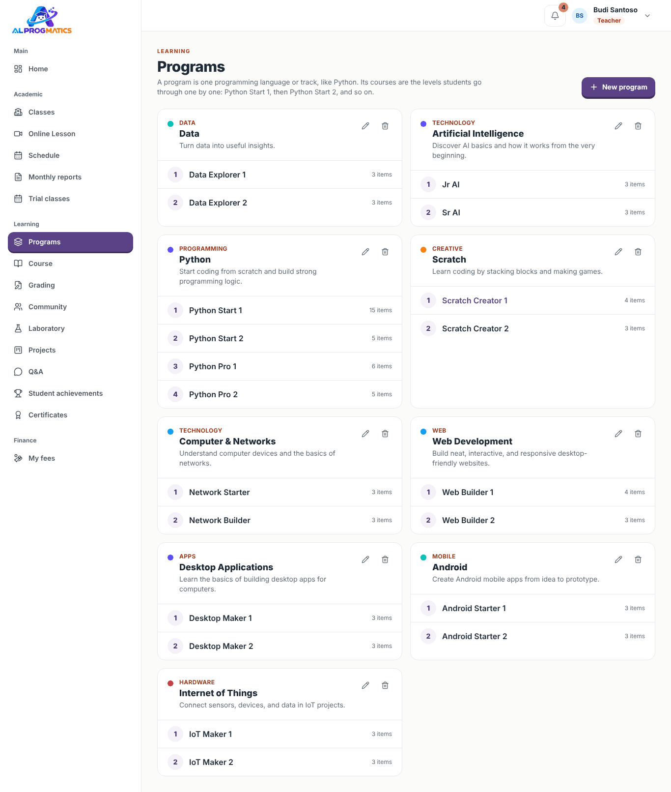

1. Buka **Programs** → **New program**. Isi **Name** (mis. "Python"), **Color**, dan **Description**, lalu **Save**.
2. Daftar **Courses without a program** di bawah menampilkan course yang belum masuk program. Klik untuk mengeditnya.

### Membuat kursus (level)

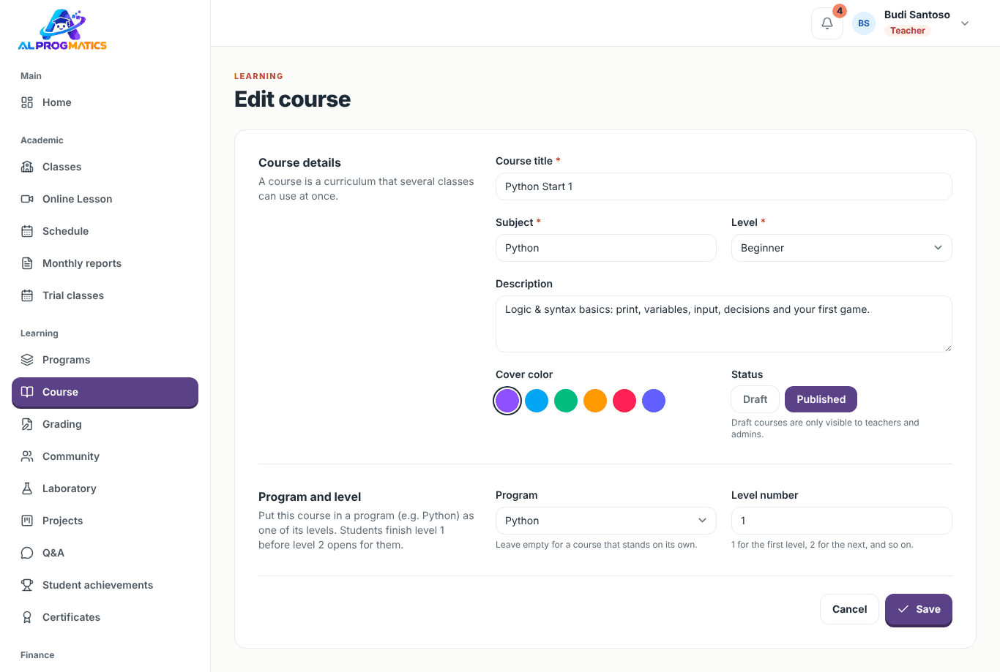

1. **Course → New course**.
2. Isi **Course title**, **Subject**, **Level**, **Description**, **Cover color**, dan **Status** (**Draft** atau **Published**).
3. Di bagian **Program and level**, pilih **Program** dan isi **Level number** (1 untuk level pertama, 2 untuk berikutnya, dst.). Kosongkan **Program** untuk course yang berdiri sendiri.
4. **Save**, lalu di halaman kursus bagian **Used in classes**, pilih kelas (**Choose a class…**) dan klik tombol **+** untuk memasang. Kelas yang sudah memakai kursus lain ditandai **(switch course)**; memilihnya akan mengganti kursus kelas itu. Klik tombol **×** di samping kelas untuk melepasnya (**Detach**). Progres siswa tetap tersimpan.

### Lesson di peta

Di halaman course, kartu **Lessons on the map** mengelompokkan isi course menjadi Lesson bernomor. Siswa melihat satu lingkaran per Lesson dan isinya sebagai task.

1. Ketik nama Lesson (mis. "Variables and input") lalu klik **+**. Nomor Lesson mengikuti urutan task pertamanya.
2. Di daftar **Course content**, pilih Lesson untuk setiap item lewat menu di barisnya (**Not in a lesson** untuk mengeluarkannya). Urutan task di dalam Lesson mengikuti panah naik/turun.
3. Ikon pensil mengganti nama Lesson; ikon **×** menghapusnya (task-nya tetap ada di course).

Item yang tidak masuk Lesson tampil sebagai lingkaran sendiri di peta, sehingga course lama tetap berjalan. Task "Mixed" di prototipe (pilihan ganda dan coding dalam satu task) dibuat sebagai dua task berurutan dalam Lesson yang sama.

### Membuka Lesson untuk kelas (Lesson access)

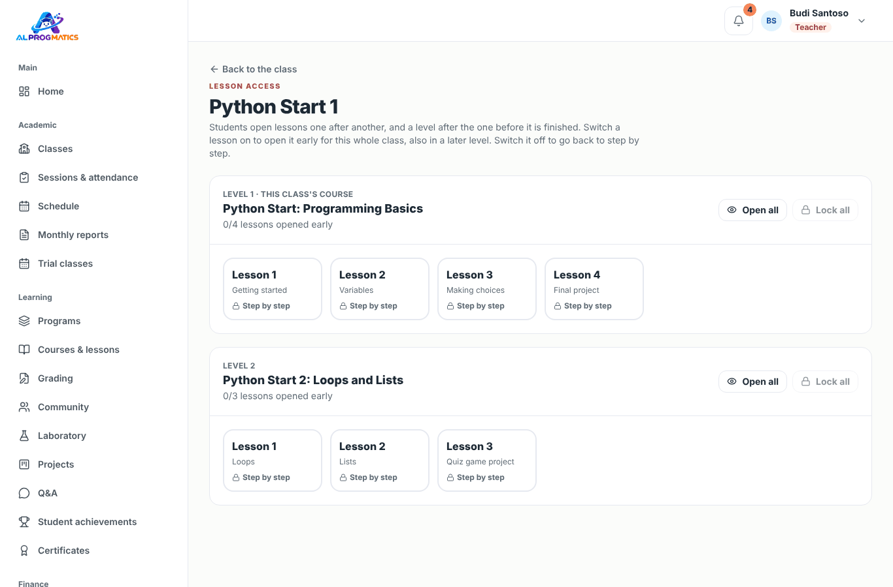

Siswa membuka Lesson **berurutan** (Lesson 2 terbuka setelah semua task Lesson 1 selesai) dan naik level setelah level sebelumnya selesai. Guru kelas bisa membuka Lesson lebih awal untuk seluruh kelas, seperti tombol Open/Locked di prototipe klien.

1. Buka kelas di **Classes**, lalu klik **Lesson access** (hanya muncul untuk guru kelas itu dan admin, dan bila kelas sudah memakai course).
2. Halaman menampilkan level kelas ini (**this class's course**) dan level lain di program yang sama.
3. Klik kartu Lesson untuk membukanya (**Open**). Klik lagi untuk kembali ke aturan berurutan (**Step by step**).
4. **Open all** membuka semua Lesson di level itu; **Lock all** mengembalikan semuanya ke aturan berurutan.

Membuka Lesson di level berikutnya membuat level itu muncul di peta siswa dengan hanya Lesson tersebut yang bisa dibuka. Pengaturan ini berlaku per kelas, jadi kelas lain yang memakai level yang sama tidak terpengaruh.

### Siswa yang tertarik

Siswa bisa membuka katalog kursus (`/courses/explore`) dan melihat kursus yang belum mereka ikuti dalam mode pratinjau (isi pelajaran tetap terkunci). Bila siswa menekan **I'm interested**, admin dan orang tuanya mendapat notifikasi, dan nama siswa muncul di kartu **Interested students** di halaman kursus. Gunakan daftar ini untuk menawarkan kelas atau kelas trial.

Saat siswa membuka pelajaran, mereka melihatnya dalam mode fokus tanpa menu samping (lihat [panduan siswa](siswa.md#belajar-materi-kuis-dan-tugas)). Guru dan admin tetap melihat tampilan biasa dengan daftar isi kursus di samping.

### Menambah isi kursus

Di bagian **Course content** halaman kursus, gunakan tombol **Lesson**, **Quiz**, **Assignment**, atau **Coding**. Urutkan dengan tombol panah naik/turun (**Move up**/**Move down**). Setiap pelajaran punya pilihan **Show to students**; matikan untuk menyimpannya sebagai draf (**Draft**).

**Lesson** (materi): **Title**, **Lesson content** (Markdown: judul, daftar, `kode`, tautan, blok kode), **Video link (YouTube/Vimeo)**, dan **Estimated duration (minutes)**. Siswa menandai materi selesai setelah membaca.

**Quiz** (dinilai otomatis):

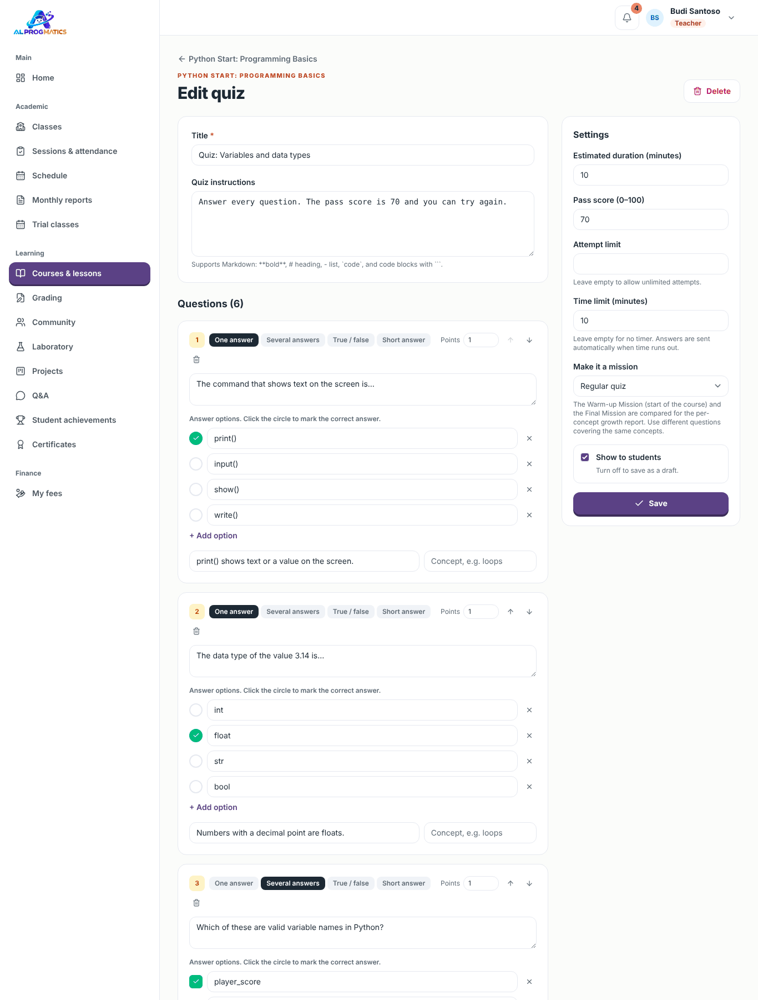

1. Tulis pertanyaan, lalu pilih jenis soal:
   - **One answer**: pilihan ganda dengan satu jawaban benar. Klik lingkaran untuk menandai jawaban benar.
   - **Several answers**: pilihan ganda dengan beberapa jawaban benar. Siswa harus memilih semuanya.
   - **True / false**: klik lingkaran di samping jawaban yang benar. Label bisa diganti, mis. *Yes / No*.
   - **Short answer**: siswa mengetik jawaban. Isi satu atau beberapa jawaban yang diterima (**+ Add accepted answer**, maks. 6). Huruf besar/kecil, spasi berlebih, dan titik di akhir diabaikan; angka dicocokkan berdasarkan nilainya (2.5 = 2,50).
2. Opsional: pembahasan (**Explanation**, tampil setelah siswa lulus), konsep soal (**Concept**, mis. "loops"), dan **Points**. Urutkan soal dengan panah naik/turun, tambah soal dengan **Add question**.
3. **Settings**: **Pass score (0–100)**, **Attempt limit** (kosongkan agar tidak dibatasi), **Time limit (minutes)**, dan **Make it a mission**:
   - **Regular quiz**.
   - **Warm-up Mission**: dikerjakan di awal kursus (pre-test). Tidak memengaruhi nilai.
   - **Final Mission**: dikerjakan di akhir kursus (post-test).
   Hasil kedua misi dibandingkan per konsep untuk laporan **Skill growth** di rapor. Pakai soal berbeda dengan konsep yang sama.

Timer kuis: bila **Time limit (minutes)** diisi (1–180), siswa harus menekan **Start quiz** dulu. Waktu mulai disimpan di server, jadi jam tetap berjalan walau siswa memuat ulang halaman atau pindah perangkat. Jawaban terkirim otomatis saat waktu habis. Jawaban yang tiba lebih dari 30 detik setelah batas waktu tetap dinilai, tetapi tidak dihitung lulus. Kosongkan isian ini untuk kuis tanpa timer.

Kunci jawaban baru terlihat siswa setelah mereka lulus (atau setelah kesempatan mencoba habis). Di halaman kuis, guru melihat **Student results** (percobaan dan nilai terbaik per siswa) serta **Questions and answer key**.

**Assignment** (tugas): **Title**, **Assignment instructions**, dan **Maximum score**. Siswa mengumpulkan jawaban teks, tautan proyek, dan/atau berkas (JPG, PNG, PDF, ZIP, SB3, PY, HTML, TXT, JS, CSS; maks. 20 MB). Di halaman tugas, guru melihat **Student submissions** dan bisa langsung menilai lewat **Grade**.

**Tugas Scratch.** Di form tugas, pilih **Students work in: Scratch editor**. Siswa lalu membuat proyek di editor Scratch yang ada di halaman tugas dan menekan **Submit**; berkas `.sb3` terlampir otomatis. Di **Student submissions**, klik **Play Scratch project** untuk memutar proyek siswa (bendera hijau) tanpa mengunduhnya. Pilihan **Anywhere (link, file or text)** mempertahankan cara lama.

### Soal coding

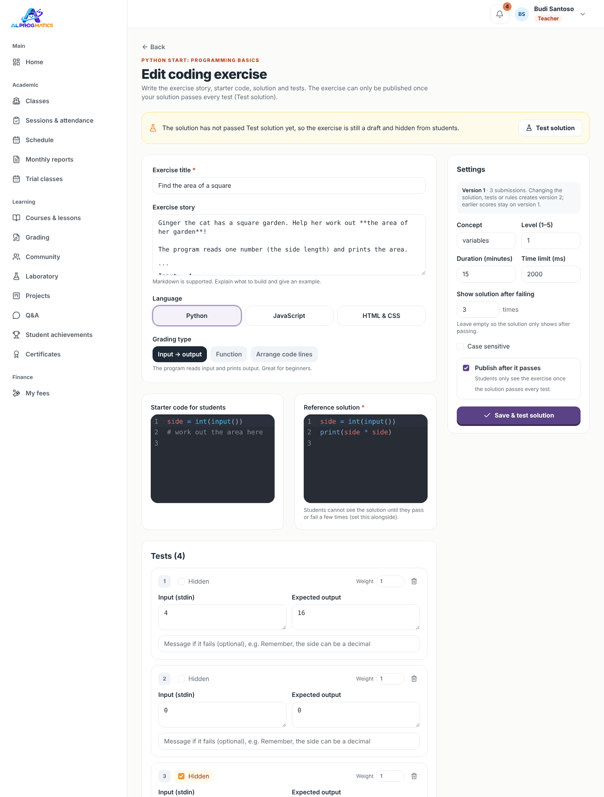

Kode siswa dijalankan di browser mereka, lalu server membandingkan hasilnya dengan jawaban yang hanya disimpan di server.

1. Di halaman kursus, klik **Coding**.
2. Isi **Exercise title** dan **Exercise story**, lalu pilih **Language** (**Python**, **JavaScript**, **HTML & CSS**) dan **Grading type**:
   - **Input → output**: program membaca input lalu mencetak output. Cocok untuk pemula.
   - **Function**: siswa menulis fungsi dengan nama tertentu (**Function name**); tiap tes berisi **Arguments (JSON)** dan **Return value (JSON)**.
   - **HTML/CSS check** (khusus HTML & CSS): halaman siswa dicek dengan **Checking rules** berbasis **CSS selector**: **Element exists**, **Element text contains**, **Element attribute**, **Minimum element count**, dan **Element CSS style**.
   - **Arrange code lines** (Parsons): siswa menyusun baris solusi yang diacak. Tidak perlu tes.
3. Isi **Starter code for students** dan **Reference solution** Anda.
4. Tambah tes (**+ Add test**): **Input (stdin)** atau argumen, **Expected output** atau nilai return, **Weight**, pesan bila gagal, dan centang **Hidden** untuk kasus tepi. Jawaban tes tersembunyi tidak pernah dikirim ke browser siswa.
5. Opsional, tambah **Code rules** (maks. 10), yang dicek di server saat siswa mengumpulkan:
   - **Must use**, mis. `for` (siswa wajib memakai perulangan).
   - **Must not use**, mis. `sum` (siswa tidak boleh memakai fungsi bawaan itu).
   - **At most N lines**, mis. `6`.
   Komentar dan teks di dalam tanda kutip diabaikan, jadi aturan tidak bisa diakali dengan menulis kata kuncinya di komentar. Kata seperti `for` dicocokkan sebagai kata utuh (tidak cocok dengan `format`). Isi pesan bila gagal (opsional).
6. Tambah **Step-by-step hints** (maks. 5), yang terbuka satu per satu saat siswa memintanya.
7. **Settings**: **Concept**, **Level (1–5)**, **Duration (minutes)**, **Time limit (ms)**, **Show solution after failing** N **times** (kosongkan agar solusi hanya tampil setelah lulus), dan **Case sensitive** (khusus Input → output).
8. Biarkan **Publish after it passes** tercentang, lalu klik **Save & test solution**. Soal baru terlihat siswa bila solusi Anda lulus semua tes. Bila belum lulus, soal tetap draf; perbaiki lalu klik **Test solution** (atau **Test & publish**) di bagian atas form.

Di halaman soal, guru punya tab **Try it**, **Answer key & tests**, dan **Student work**. Tab **Student work** menampilkan kode terbaru tiap siswa, cocok untuk dibahas bersama saat sesi Zoom.

#### Versi soal

Bila Anda mengubah solusi, tes, atau aturan kode setelah ada siswa yang mengumpulkan, sistem membuat versi baru soal. Kotak di **Settings** menampilkan **Version N** dan jumlah pengumpulan pada versi itu. Nilai lama tetap tercatat pada versi lamanya; di riwayat siswa, nilai dari versi lama diberi tanda **vN**. Mengubah judul atau cerita soal saja tidak membuat versi baru.

## Laporan masalah dari siswa

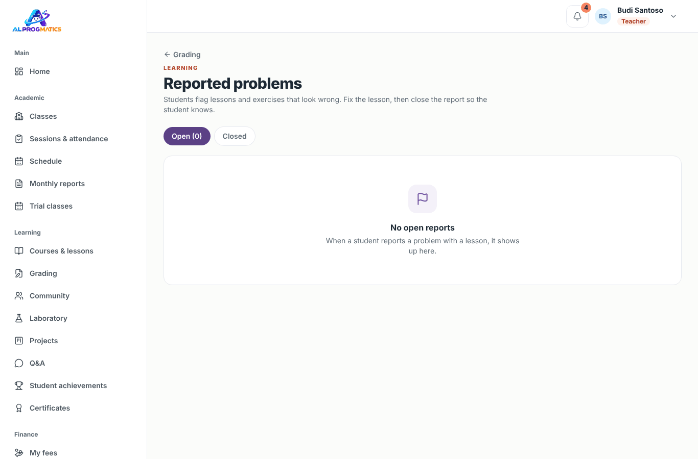

Di setiap materi, kuis, tugas, dan soal coding, siswa punya tombol **Report a problem** untuk melaporkan soal yang keliru, misalnya **The answer or a test seems wrong**, **The instructions are unclear**, atau **Something is broken or has a typo**. Guru kelas yang memakai kursus itu, pembuat kursus, dan admin menerima notifikasi.

1. Buka **Grading → Reported problems** (alamat `/lesson-reports`). Angka di tombol menunjukkan laporan yang masih terbuka. Guru hanya melihat dan menutup laporan untuk kursus yang ia buat atau yang dipakai kelasnya; admin melihat semuanya. Halaman pelajaran yang punya laporan terbuka juga menampilkan pengingat dengan tautan **Review reports**.
2. Tab **Open** berisi laporan yang belum ditangani, **Closed** berisi yang sudah ditutup.
3. Klik **Edit lesson** untuk memperbaiki pelajaran (untuk soal coding, perubahan tes atau solusi membuat versi baru).
4. Klik **Close report**, pilih **Fixed it** atau **No change needed**, isi **Message to the student (optional)**, lalu **Close and notify**. Siswa pelapor menerima notifikasi.

## Penilaian tugas

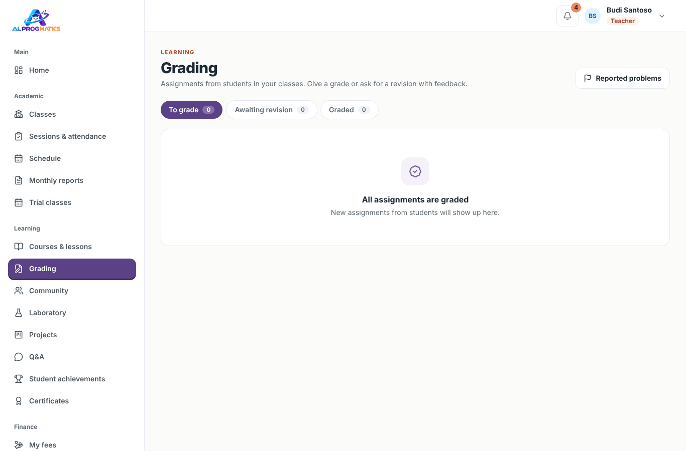

1. Buka **Grading**. Tab: **To grade**, **Awaiting revision**, **Graded**.
2. Baca jawaban, buka tautan atau unduh berkas siswa.
3. Isi **Score** dan umpan balik, lalu klik **Save grade**. Atau klik **Ask for revision** dengan umpan balik tentang apa yang perlu diperbaiki (wajib diisi).
4. Siswa (dan orang tua) menerima notifikasi. Nilai yang sudah diberikan bisa diubah lewat **Edit grade**.

## Rapor progres siswa

Rapor siswa menampilkan progres setiap kursus: persentase selesai (**Progress**), **Quiz average**, **Assignment average**, dan **Skill growth** dari **Warm-up Mission** ke **Final Mission**. Kenaikan (**Gain**) dihitung sebagai (akhir − awal) ÷ (100 − awal) dan diberi label **High** (≥ 70%), **Medium** (≥ 30%), atau **Low**.

Saat ini rapor belum punya tautan di menu guru. Buka lewat alamat `/progress/<ID siswa>` (ID terlihat di alamat halaman prestasi siswa, `/achievements/student/<ID>`). Guru hanya bisa membuka rapor siswa di kelas yang ia ajar. Hasil kuis per pelajaran juga terlihat di bagian **Student results** pada halaman kuis.

Siswa sendiri melihat kursusnya sebagai peta perjalanan (*course map*) di menu **Course**: satu lingkaran per pelajaran dari **START** sampai **Finish**, dengan pelajaran yang sudah selesai, pelajaran yang sedang dikerjakan, dan yang berikutnya. Urutan peta mengikuti urutan pelajaran di **Course content**, dan pelajaran draf tidak tampil.

## Laporan bulanan

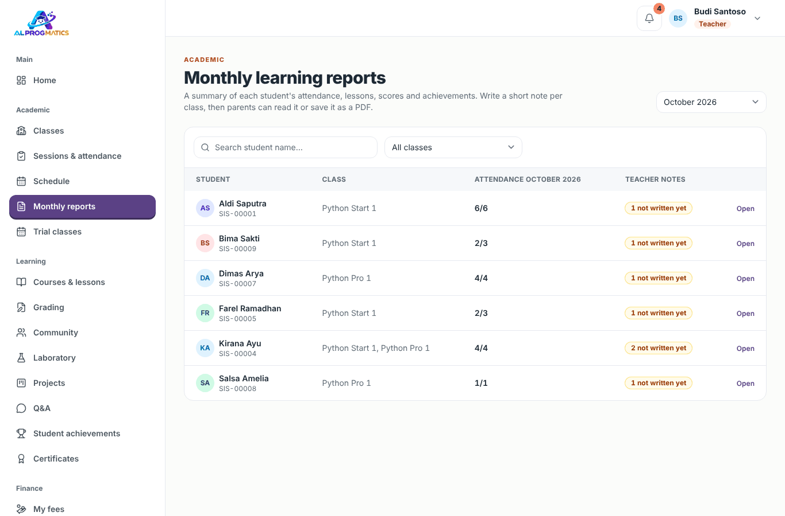

Laporan bulanan merangkum kehadiran, materi yang diselesaikan, nilai kuis dan tugas, latihan coding, proyek, serta prestasi siswa dalam satu bulan. Orang tua membacanya di portal dan bisa mencetak atau menyimpannya sebagai PDF.

1. Buka **Monthly reports**. Pilih bulan di kanan atas (selama minggu pertama bulan baru, yang terbuka otomatis adalah bulan sebelumnya). Cari siswa lewat **Search student name…** atau saring per kelas (**All classes**).
2. Kolom **Teacher notes** menunjukkan catatan yang belum ditulis (**N not written yet**) atau sudah lengkap (**Complete**). Klik baris siswa atau **Open**.
3. Di bagian **Note for parents · <nama kelas>**, isi **Going well** dan **Focus for next month**, lalu **Save note**. Catatan ditulis per kelas per bulan, jadi siswa yang ikut dua kelas Anda mendapat dua catatan. Bagian isian ini tidak ikut tercetak.
4. Gunakan panah bulan untuk pindah bulan dan **Print / save PDF** untuk mencetak.

Guru hanya melihat siswa dari kelas yang ia ajar dan hanya bisa menulis catatan untuk kelasnya sendiri.

## Kelas percobaan (trial)

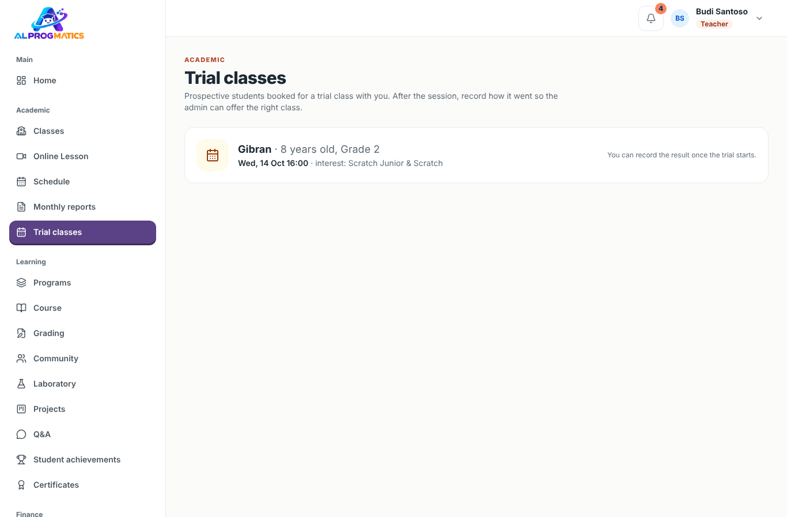

Calon siswa yang mendaftar lewat formulir free trial dijadwalkan oleh admin untuk kelas percobaan dengan guru tertentu. Anda mendapat notifikasi saat admin menjadwalkan trial dengan Anda.

1. Buka **Trial classes**. Setiap kartu menampilkan nama dan usia anak, waktu trial, minat, pesan dari orang tua, dan tombol **Zoom** bila link sudah diisi admin.
2. Setelah trial dimulai, klik **Record result**. Sebelum itu kartu menampilkan "You can record the result once the trial starts."
3. Isi **How did the trial go?**, **Child’s enthusiasm (1–5)**, dan **Recommended class** (opsional), lalu **Save result**. Admin mendapat notifikasi untuk menawarkan kelas ke orang tua.
4. Hasil yang sudah tersimpan tampil di **Recent trial results** dan bisa diubah lewat **Edit** selama admin belum menindaklanjutinya.

## Tanya Jawab

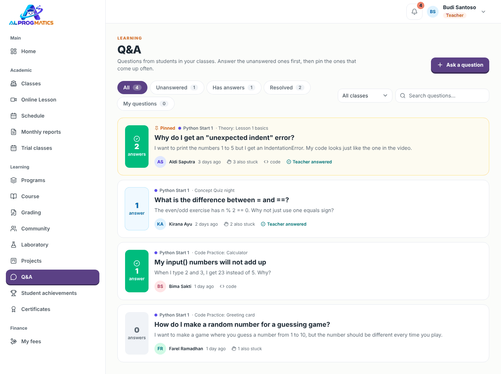

Siswa bertanya per kelas, opsional terkait pelajaran tertentu.

1. Buka **Q&A**. Mulai dari tab **Unanswered**. Beranda juga menampilkan pertanyaan yang belum dijawab.
2. Buka pertanyaan, tulis jawaban (bisa menambahkan kode lewat **Add code**), klik **Send answer**. Jawaban guru diberi tanda **Teacher** dan tampil paling atas. Penanya mendapat notifikasi.
3. Klik **Pick as best answer** pada jawaban yang paling tepat (penanya juga bisa). Jawaban itu ditandai **Best answer**.
4. Klik **Pin** untuk pertanyaan yang sering ditanyakan agar tampil di atas untuk seluruh kelas. Klik **Mark as answered** untuk menandai pertanyaan selesai (**Resolved**).

Pertanyaan bertanda **Teacher only** hanya terlihat oleh guru, admin, penanya, dan orang tuanya. Pertanyaan yang **anonymous to classmates** tetap menampilkan nama penanya kepada guru dan orang tua.

## Proyek (kanban)

Setiap siswa di kelas otomatis mendapat papan kanban sendiri dengan kolom **To do → Doing → Ready for review → Done**.

### Membuat proyek

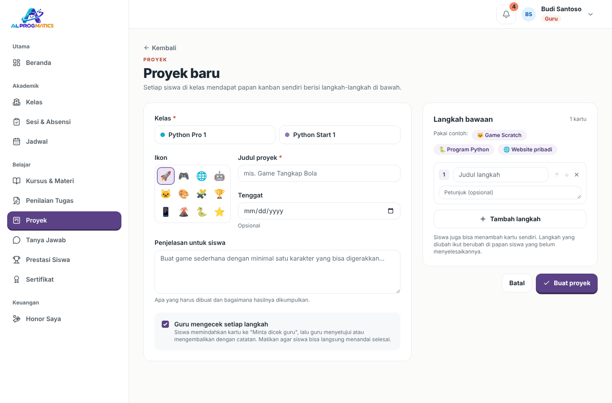

1. **Projects → New project**.
2. Pilih **Class**, **Icon**, **Project title**, **Due date** (opsional), dan **Instructions for students**.
3. Atur **Teacher reviews every step**. Bila aktif, siswa memindahkan kartu ke **Ready for review** dan Anda menyetujui atau mengembalikannya. Matikan agar siswa bisa langsung menandai selesai.
4. Isi **Default steps** (**Add step**), atau pilih template di **Use a template:** (**Scratch game**, **Python program**, **Personal website**). Siswa juga bisa menambah kartu sendiri.
5. Klik **Create project**. Langkah yang diubah kemudian ikut berubah di papan siswa yang belum menyelesaikannya.

### Memantau dan mengecek

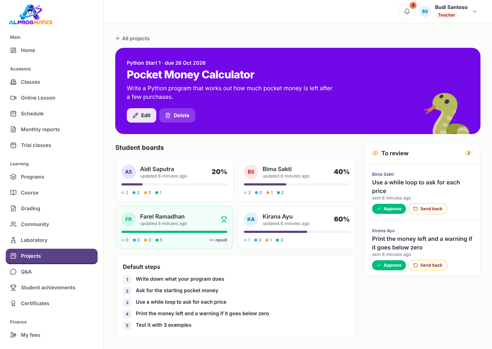

- Halaman proyek menampilkan **Student boards** (progres setiap siswa) dan antrean **To review**.
- Pada kartu yang menunggu, klik **Approve**, atau **Send back** dengan catatan "What needs fixing?" lalu **Send note**.
- Buka papan siswa untuk melihat kartu dan **Project result** (link karya dan cerita singkat).
- Lewat **Edit**, ubah **Status** menjadi **Archived** untuk mengunci papan siswa setelah proyek selesai.

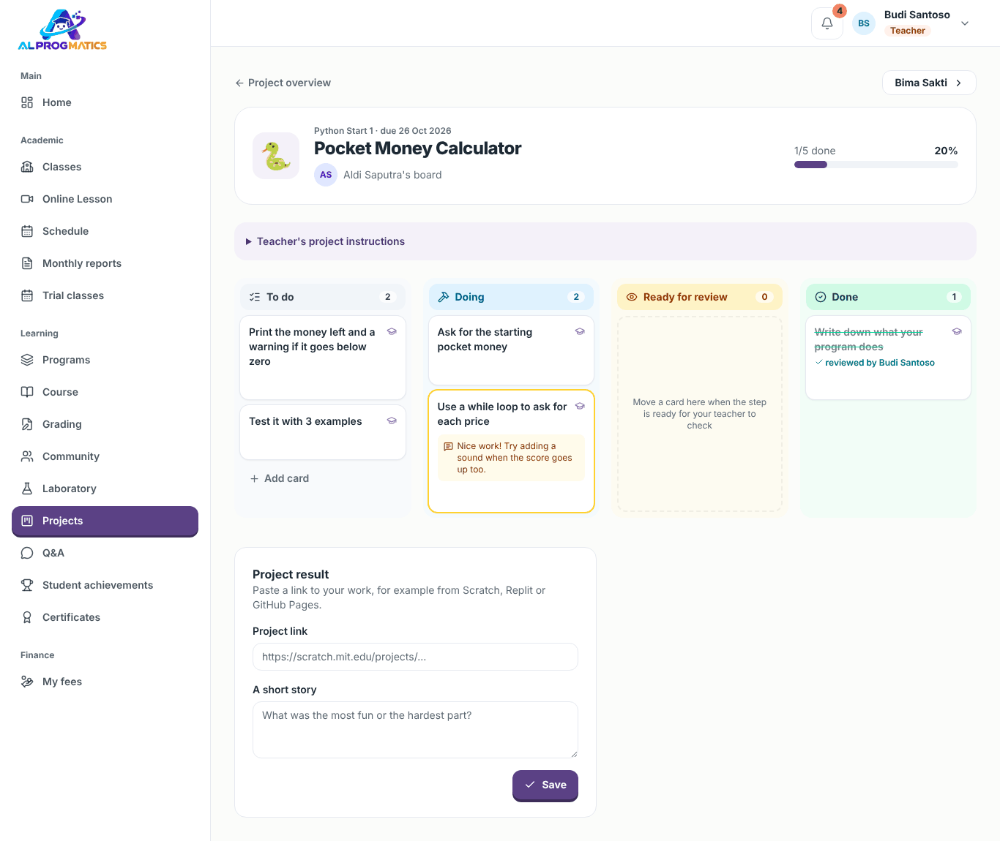

## Laboratorium dan Komunitas

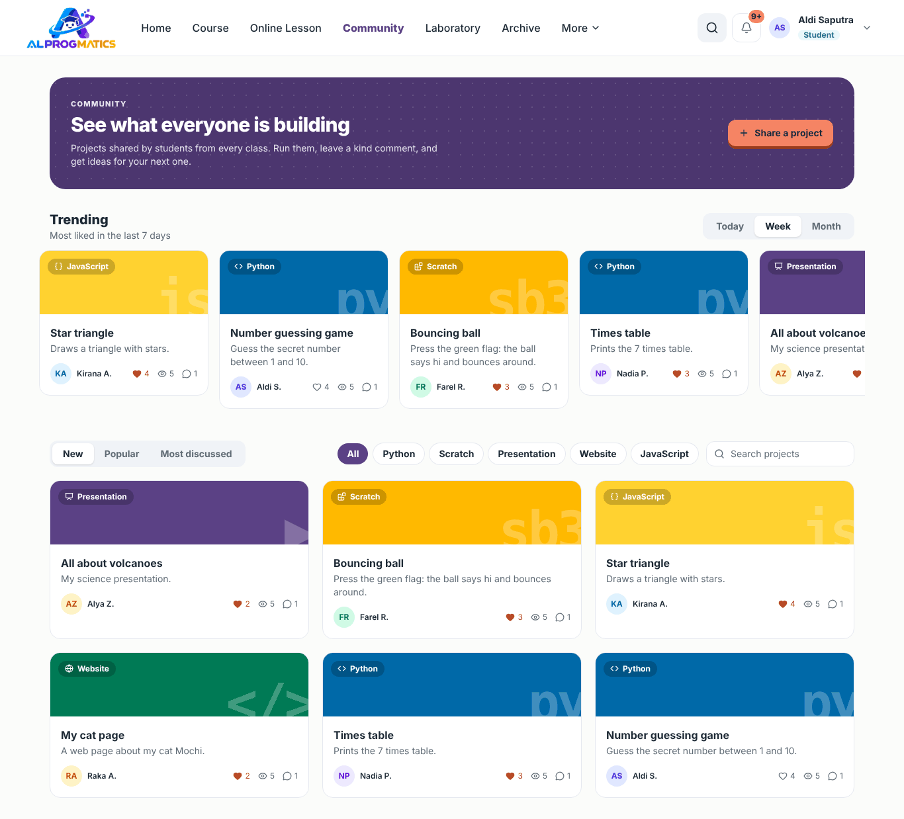

- **Laboratory** adalah ruang berkarya bebas untuk guru dan siswa: **Python**, **Scratch** (editor Scratch lengkap), **Presentation** (slide; `---` memisahkan slide), **Website**, dan **JavaScript**. Klik **New project**, kerjakan, lalu **Save** atau **Save & share** untuk membagikannya ke Komunitas. Guru bisa memakainya untuk menyiapkan contoh atau slide sebelum kelas.
- **Community** menampilkan proyek yang dibagikan siswa dari semua kelas, dengan **Trending** (**Today** / **Week** / **Month**), urutan **New**, **Popular**, **Most discussed**, filter jenis, dan pencarian. Proyek Scratch diputar dengan bendera hijau, presentasi dengan **Back** / **Next**. Guru juga bisa menyukai dan mengomentari karya siswa.

Moderasi oleh guru:

- Hapus komentar yang tidak pantas dengan ikon tempat sampah (**Delete comment**).
- Bila sebuah proyek tidak layak tampil, buka proyeknya dan klik **Remove from Community**. Proyek tetap ada di Laboratorium pemiliknya, tetapi tidak terlihat orang lain dan tidak bisa dibagikan ulang. Pemiliknya melihat label **Removed by teacher**.
- Untuk mengembalikannya, buka lagi halaman proyek itu dan klik **Put it back**. Proyek yang dihapus dari Komunitas tidak lagi muncul di daftar, jadi simpan tautannya bila Anda berencana mengembalikannya.

## Prestasi siswa

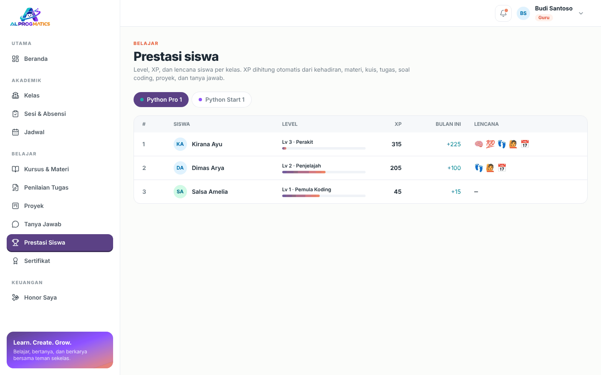

Menu **Student achievements** menampilkan **Level**, **XP** total, XP bulan ini (**This month**), dan lencana (**Badges**) siswa per kelas. XP dihitung otomatis dari kehadiran, materi, kuis, tugas, soal coding, proyek, dan tanya jawab, jadi guru tidak perlu memberi poin manual.

## Sertifikat

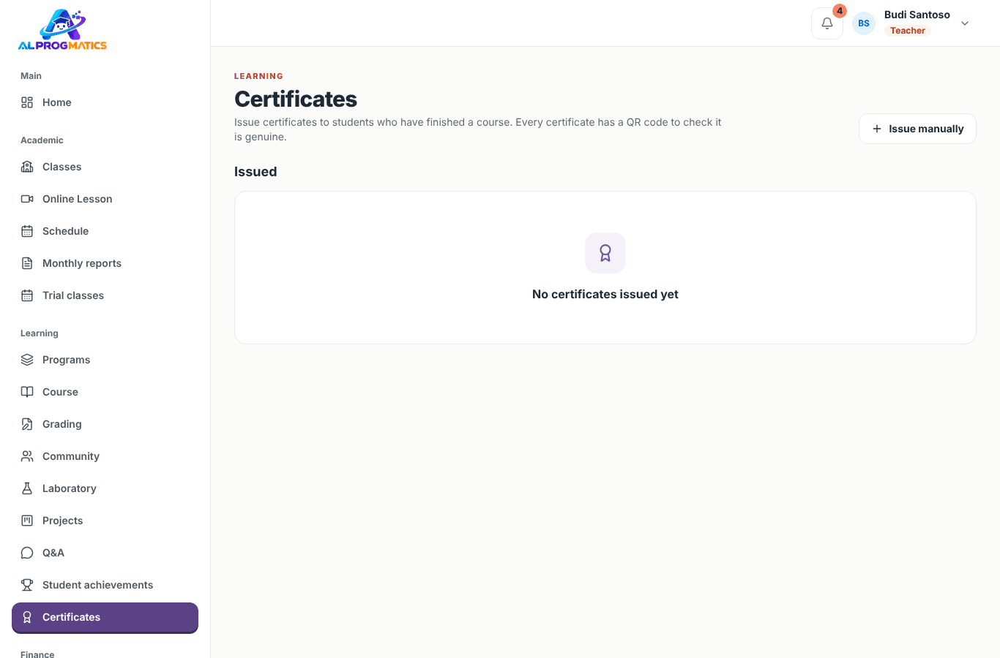

1. Buka **Certificates**. Siswa yang sudah menyelesaikan semua pelajaran kursus kelasnya muncul otomatis di kotak **... ready for a certificate**. Klik **Issue** untuk menerbitkan sekali klik.
2. Untuk penghargaan lain (mis. juara lomba), klik **Issue manually**: pilih **Class** dan **Student**, isi **Title**, **Description** (mis. "for winning 1st place in the Scratch Game Contest"), dan **Issue date**, lalu **Issue**.
3. Buka sertifikat untuk **Print / save as PDF** atau **Copy verification link**. Sertifikat bisa dicabut lewat **Revoke** bila salah terbit (dan dipulihkan lewat **Make valid again**); halaman verifikasinya akan menampilkan status dicabut.

Setiap sertifikat punya nomor, QR, dan kode verifikasi yang bisa diperiksa siapa pun di `/certificates/{kode}`:

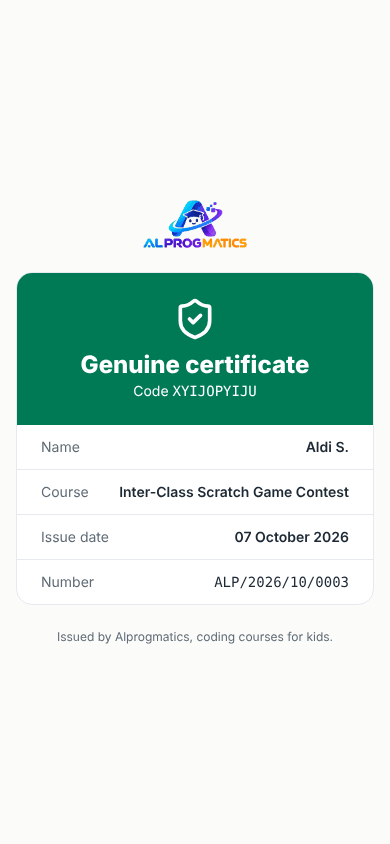

## Honor saya

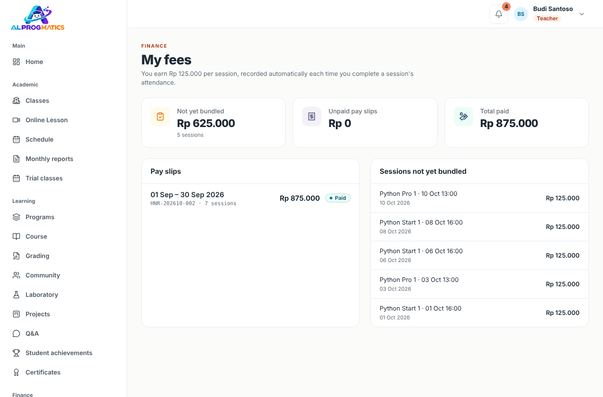

Menu **My fees** menampilkan tarif per sesi, honor yang belum direkap (**Not yet bundled**), slip yang belum dibayar (**Unpaid pay slips**), dan total yang sudah dibayar (**Total paid**), beserta daftar **Pay slips** dan **Sessions not yet bundled**. Honor tercatat otomatis setiap Anda menyelesaikan laporan sesi. Admin merekap honor menjadi slip setiap akhir bulan; buka slip untuk melihat rincian dan mencetaknya.
