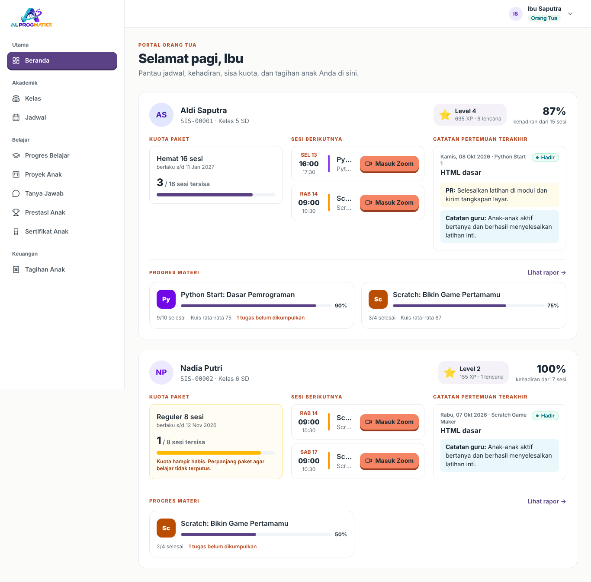
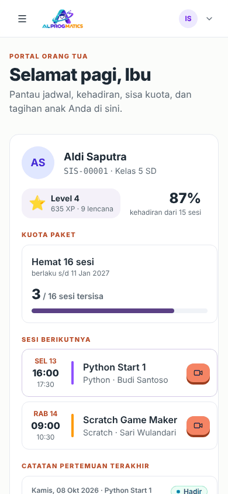
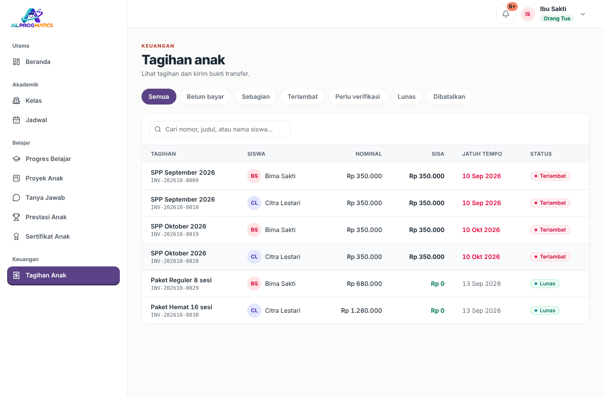
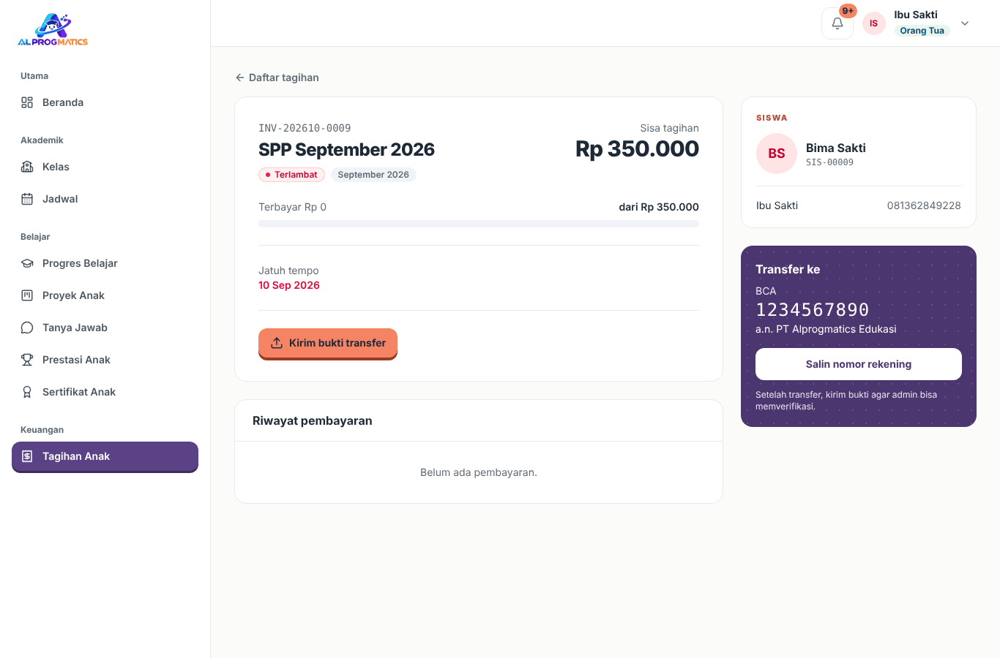
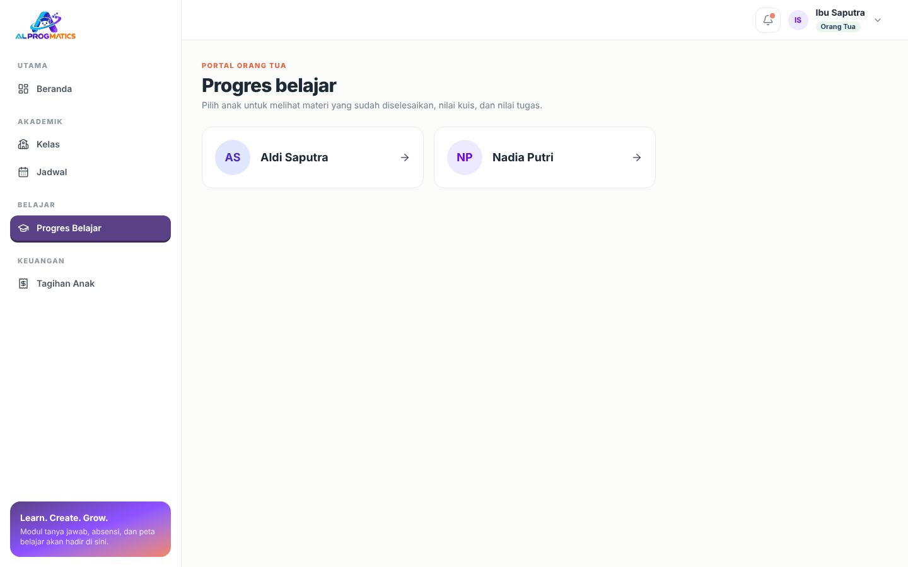
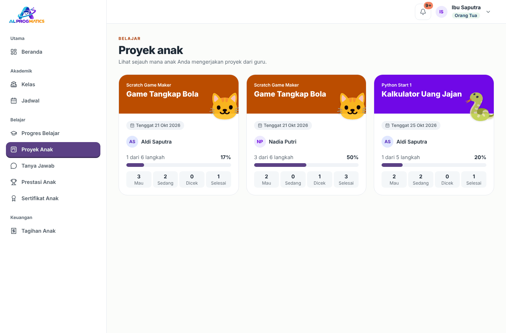
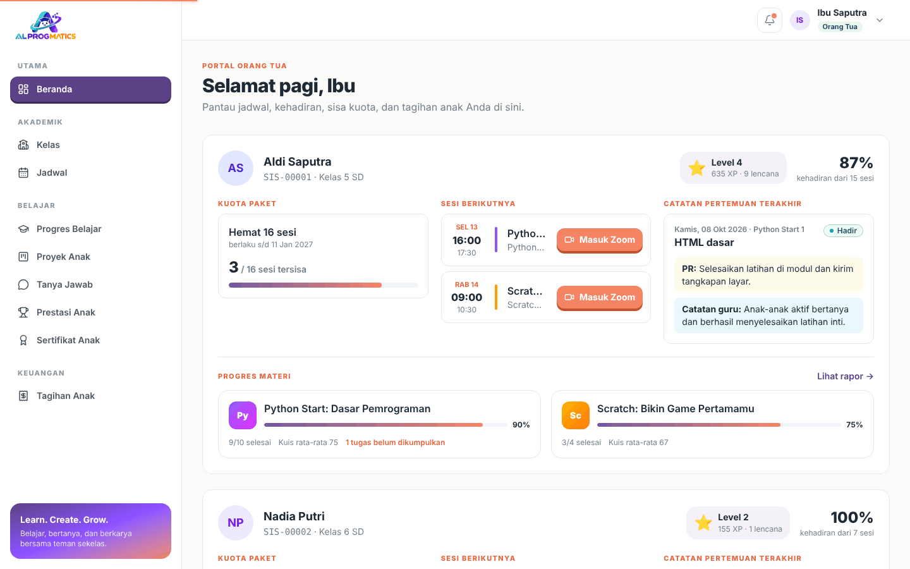
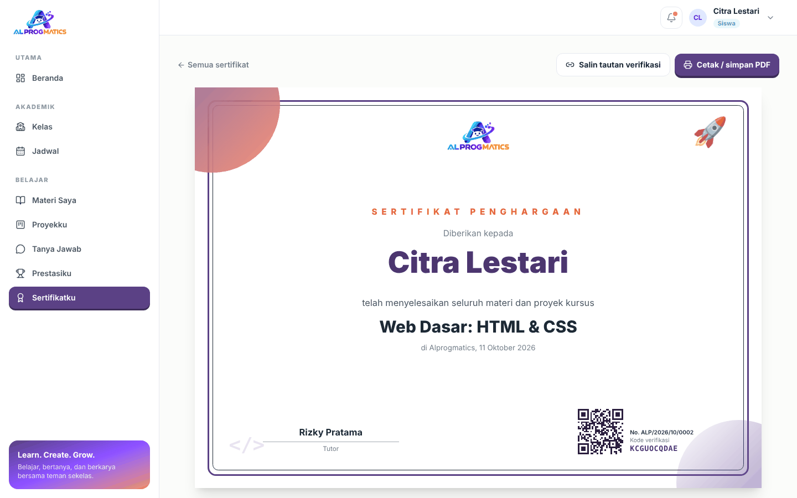

# Panduan Orang Tua

Portal orang tua membantu Anda memantau jadwal, kehadiran, sisa kuota paket, progres belajar, proyek, prestasi, dan sertifikat anak, serta membayar tagihan dengan mengirim bukti transfer.

Akun Anda dibuat oleh admin dan dihubungkan ke anak Anda. Bila anak belum muncul, hubungi admin. Panduan umum (login, lupa kata sandi, notifikasi, kalender HP) ada di [sini](README.md#hal-yang-sama-untuk-semua-peran).

## Beranda

Setiap anak tampil dalam satu kartu berisi:

- **Level dan XP** anak (klik untuk membuka prestasinya) dan **persentase kehadiran**.
- **Kuota paket**: sisa sesi dan masa berlaku paket.
- **Sesi berikutnya** dengan tombol **Masuk Zoom**, berguna bila Anda mendampingi anak.
- **Catatan pertemuan terakhir**: status kehadiran, materi, PR, dan catatan guru untuk orang tua.
- **Progres materi** per kursus. Klik **Lihat rapor** untuk rapor lengkap.
- Tagihan yang belum lunas, dengan pengingat untuk transfer lalu kirim bukti.

Bila Anda punya lebih dari satu anak, setiap anak tampil dalam kartu terpisah.

Tampilan ini juga nyaman dibuka dari HP:

## Membayar tagihan

Pembayaran dilakukan lewat transfer bank manual, lalu bukti transfer dikirim melalui aplikasi.

1. Buka **Tagihan Anak**, atau klik notifikasi tagihan baru.
2. Pilih tagihan. Halaman tagihan menampilkan sisa tagihan, jatuh tempo, dan rekening tujuan (**Transfer ke**). Klik **Salin nomor rekening** untuk menyalin.
3. Transfer lewat bank atau m-banking Anda.
4. Kembali ke halaman tagihan, klik **Kirim bukti transfer**, lalu isi:
   - **Nominal** yang ditransfer (boleh sebagian).
   - **Tanggal transfer** dan **Metode** (transfer bank/tunai).
   - **Bank pengirim** dan **Nama pemilik rekening**.
   - **Bukti transfer**: foto atau tangkapan layar (JPG, PNG, atau PDF, maks. 4 MB).
   - Catatan (opsional).
5. Kirim. Pembayaran berstatus **Menunggu verifikasi**.
6. Setelah admin memeriksa mutasi, Anda mendapat notifikasi: **Terverifikasi** (tagihan menjadi *Sebagian* atau *Lunas*) atau **Ditolak** beserta alasannya. Bila ditolak, perbaiki lalu kirim bukti lagi.

Tagihan yang sudah dibayar punya tombol **Kuitansi** untuk dicetak atau disimpan sebagai PDF.

### Paket kuota

Kursus memakai paket sesi (mis. 8 atau 16 sesi). Paket aktif setelah tagihannya lunas, lalu terpotong setiap sesi:

- **Hadir** dan **Alpa** (tidak hadir tanpa kabar) memotong kuota.
- **Izin** dan **Sakit** tidak memotong kuota. Kabari guru sebelum kelas bila anak berhalangan.

Sisa kuota terlihat di Beranda. Admin akan menghubungi Anda saat kuota hampir habis.

## Progres belajar (rapor)

Menu **Progres Belajar** (atau **Lihat rapor** di Beranda) menampilkan setiap kursus anak:

- Persentase pelajaran selesai, rata-rata kuis, dan rata-rata tugas.
- Status setiap pelajaran (selesai, nilai, menunggu dinilai, belum dikerjakan).
- **Kenaikan kemampuan**: perbandingan nilai Misi Pemanasan (awal kursus) dan Misi Akhir (akhir kursus) per konsep. Label Tinggi, Sedang, atau Rendah menunjukkan seberapa besar kemajuan anak dari titik awalnya.

## Proyek anak

Menu **Proyek Anak** menampilkan proyek dari guru beserta progresnya. Buka proyek untuk melihat papan kanban anak: langkah yang sedang dikerjakan, yang menunggu dicek guru, yang sudah selesai, catatan guru, dan link hasil karya anak. Orang tua hanya bisa melihat, tidak mengubah papan.

## Tanya Jawab

Menu **Tanya Jawab** menampilkan pertanyaan anak Anda beserta jawabannya, termasuk pertanyaan yang dibuat "hanya guru" atau disembunyikan namanya dari teman. Orang tua bisa membaca tetapi tidak menjawab; untuk berdiskusi, hubungi guru kelas secara langsung.

## Prestasi dan sertifikat

- **Prestasi Anak** menampilkan level, total XP, XP bulan ini, lencana, dan riwayat XP terbaru. XP dihitung otomatis dari kehadiran, materi, kuis, tugas, soal coding, proyek, dan tanya jawab.
- **Sertifikat Anak** berisi sertifikat yang sudah diterbitkan guru. Klik sertifikat lalu **Cetak / simpan PDF**. Keaslian sertifikat bisa diperiksa siapa pun dengan memindai QR-nya.

## Jadwal dan notifikasi

- **Jadwal** menampilkan sesi kelas anak minggu ini (WIB). Pasang ke kalender HP agar mendapat pengingat dari kalender Anda (lihat [panduan umum](README.md#jadwal-di-kalender-hp)).
- **Lonceng** memberi tahu tagihan baru, hasil verifikasi pembayaran, dan ringkasan setiap sesi anak.
- Notifikasi saat ini hanya tampil di aplikasi. Pengiriman lewat WhatsApp belum tersedia.
