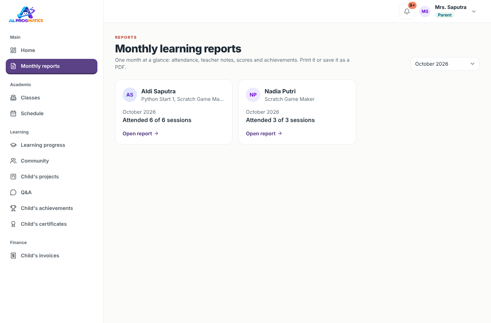
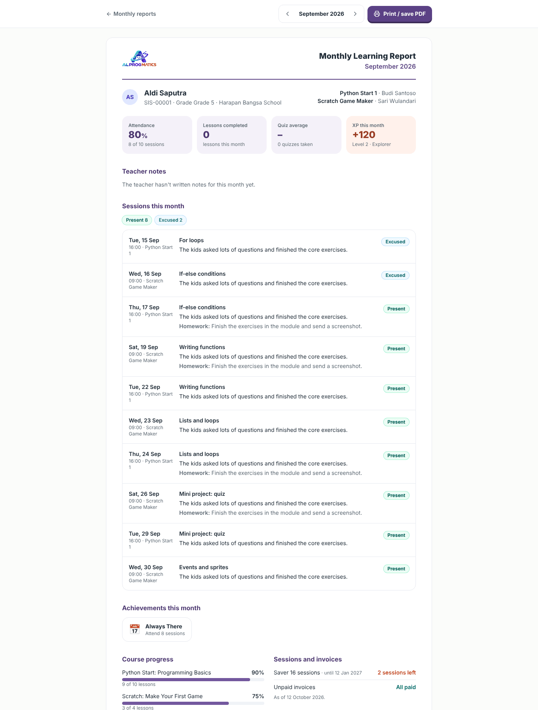

# Panduan Orang Tua

Portal orang tua membantu Anda memantau jadwal, kehadiran, sisa kuota paket, progres belajar, laporan bulanan, proyek, prestasi, dan sertifikat anak, serta membayar tagihan dengan mengirim bukti transfer.

Akun Anda dibuat oleh admin dan dihubungkan ke anak Anda. Bila anak belum muncul (Beranda menampilkan **No children linked yet**), hubungi admin. Panduan umum (login, lupa kata sandi, notifikasi, kalender HP) ada di [sini](README.md#hal-yang-sama-untuk-semua-peran).

Menu di sisi kiri untuk orang tua:

| Kelompok | Menu | Isi |
| --- | --- | --- |
| Main | **Home** | Ringkasan setiap anak dan tagihan yang belum dibayar |
| Main | **Monthly reports** | Laporan belajar bulanan yang bisa dicetak atau disimpan sebagai PDF |
| Academic | **Classes**, **Schedule** | Kelas yang diikuti anak dan jadwal mingguan |
| Learning | **Learning progress** | Rapor per kursus |
| Learning | **Community** | Karya yang dibagikan siswa (lihat, like, dan komentar) |
| Learning | **Child's projects** | Proyek dari guru beserta papan kerja anak |
| Learning | **Q&A** | Pertanyaan anak dan jawabannya (hanya baca) |
| Learning | **Child's achievements**, **Child's certificates** | Level, XP, lencana, dan sertifikat |
| Finance | **Child's invoices** | Tagihan dan pembayaran |

## Beranda

Bila ada tagihan yang belum dibayar, bagian atas Beranda menampilkan kotak kuning (mis. **1 invoice waiting for payment**) berisi daftar tagihan, sisa yang harus dibayar, dan jatuh temponya (ditandai **(overdue)** bila lewat). Klik tagihan untuk membayar, atau **All invoices →** untuk melihat semuanya.

Di bawahnya, setiap anak tampil dalam satu kartu berisi:

- **Level dan XP** anak beserta jumlah lencana (klik untuk membuka prestasinya) dan **persentase kehadiran** (mis. *attendance over 16 sessions*).
- **Package quota**: nama paket, masa berlaku (**valid until**), dan sisa sesi (**sessions left**). Bila sisa tinggal 2 sesi atau kurang muncul peringatan **Almost out of sessions**. Paket yang tidak aktif diberi label, mis. **Used up** (habis), **Expired**, atau **Awaiting payment**.
- **Next sessions**: sesi berikutnya dengan tombol **Join Zoom**, berguna bila Anda mendampingi anak. Di HP tombol ini hanya berupa ikon kamera.
- **Last session notes**: status kehadiran, materi, **Homework**, dan **Teacher's note** (catatan guru untuk orang tua). Klik judul materi untuk membuka detail sesi.
- **Learning progress** per kursus: persentase selesai, rata-rata kuis, dan tugas yang belum dikumpulkan. Klik **View report →** untuk rapor lengkap.

Bila Anda punya lebih dari satu anak, setiap anak tampil dalam kartu terpisah.

Tampilan ini juga nyaman dibuka dari HP (menu ada di tombol garis tiga di kiri atas):

## Laporan bulanan

Laporan bulanan merangkum satu bulan belajar anak dalam satu halaman: kehadiran, catatan guru, nilai, proyek, prestasi, sisa kuota, dan tagihan. Laporan ini bisa dicetak atau disimpan sebagai PDF untuk arsip.

1. Buka **Monthly reports** (alamat `/monthly-reports`). Setiap anak tampil dalam satu kartu berisi kelasnya dan ringkasan kehadiran bulan itu (mis. **Attended 6 of 6 sessions**).
2. Pilih bulan di kotak pilihan kanan atas (12 bulan terakhir). Pada tujuh hari pertama setiap bulan, halaman ini otomatis menampilkan laporan bulan sebelumnya.
3. Klik **Open report →** untuk membuka laporan lengkap. Alamatnya berbentuk `/monthly-reports/{anak}/{tahun-bulan}`, mis. `/monthly-reports/12/2026-09`.

Halaman laporan berisi:

- **Ringkasan**: **Attendance** (persentase dan jumlah sesi hadir), **Lessons completed** bulan itu, **Quiz average** beserta jumlah kuis, dan **XP this month** beserta level anak.
- **Teacher notes**: catatan bulanan dari guru setiap kelas, terdiri dari **Going well** (hal yang sudah baik) dan **Focus for next month** (fokus bulan depan). Bila guru belum menulis, tampil *The teacher hasn't written notes for this month yet.*
- **Sessions this month**: rekap status kehadiran (**Present**, **Excused**, **Sick**, **Absent**) lalu daftar setiap sesi: tanggal, jam, kelas, materi, catatan guru, dan **Homework**.
- **Lessons and scores**: pelajaran yang selesai, nilai kuis terbaik (**Quizzes (best score)**), dan tugas yang sudah dinilai (**Graded assignments**).
- **Coding practice and projects**: soal coding yang berhasil diselesaikan dan langkah proyek yang selesai bulan itu.
- **Achievements this month**: lencana dan sertifikat yang diperoleh bulan itu.
- **Course progress**: progres setiap kursus secara keseluruhan.
- **Sessions and invoices**: sisa kuota paket (**sessions left**) dan **Unpaid invoices** (tertulis **All paid** bila semua lunas). Bagian ini menunjukkan keadaan pada hari laporan dibuka, bukan pada akhir bulan laporan.

Gunakan tombol panah di samping nama bulan untuk pindah ke bulan sebelumnya atau berikutnya, dan **Monthly reports** di kiri atas untuk kembali ke daftar.

Untuk menyimpan laporan, klik **Print / save PDF**. Jendela cetak browser akan terbuka; pilih printer Anda, atau pilih *Simpan sebagai PDF* (*Save as PDF*) sebagai tujuan untuk menyimpannya sebagai berkas.

Setiap tanggal 1 pukul 08.00 WIB Anda mendapat notifikasi bahwa laporan bulan sebelumnya sudah siap. Klik notifikasi itu untuk langsung membuka laporannya. Bila ada pertanyaan tentang isi laporan, hubungi guru kelas atau admin.

## Membayar tagihan

Pembayaran dilakukan lewat transfer bank manual, lalu bukti transfer dikirim melalui aplikasi.

1. Buka **Child's invoices**, atau klik notifikasi tagihan baru. Saring tagihan dengan tab **All**, **Unpaid**, **Partially paid**, **Overdue**, **Needs verification**, **Paid**, atau **Cancelled**, atau cari berdasarkan nomor, judul, atau nama anak.
2. Pilih tagihan. Halaman tagihan menampilkan sisa tagihan (**Remaining balance**), jatuh tempo (**Due date**), dan rekening tujuan (**Transfer to**). Klik **Copy account number** untuk menyalin nomor rekening.
3. Transfer lewat bank atau m-banking Anda.
4. Kembali ke halaman tagihan, klik **Send transfer proof**, lalu isi:
   - **Amount** yang ditransfer (boleh sebagian).
   - **Transfer date**.
   - **Sending bank** dan **Account holder name** (nama pemilik rekening pengirim).
   - **Transfer proof**: foto atau tangkapan layar (JPG, PNG, atau PDF, maks. 4 MB).
   - **Notes** (opsional).
5. Klik **Send**. Pembayaran muncul di **Payment history** dengan status **Awaiting verification**.
6. Setelah admin memeriksa mutasi, Anda mendapat notifikasi: **Verified** (tagihan menjadi **Partially paid** atau **Paid**) atau **Rejected** beserta alasannya (**Rejection reason**). Bila ditolak, perbaiki lalu kirim bukti lagi.

### Kuitansi

Setelah ada pembayaran yang diverifikasi, halaman tagihan menampilkan tombol **Receipt**. Kuitansi (alamat `/finance/invoices/{id}/receipt`) berisi nama pembayar, jumlah dalam angka dan terbilang, rincian pembayaran, sisa tagihan bila ada, serta cap **Paid** atau **Partially paid**. Klik **Print / save as PDF** untuk mencetak atau menyimpannya, dan **Back to invoice** untuk kembali.

### Paket kuota

Kursus memakai paket sesi (mis. 8 atau 16 sesi). Paket aktif setelah tagihannya lunas (sebelumnya berstatus **Awaiting payment**), lalu terpotong setiap sesi:

- **Present** (hadir) dan **Absent** (tidak hadir tanpa kabar) memotong kuota.
- **Excused** (izin) dan **Sick** (sakit) tidak memotong kuota. Kabari guru sebelum kelas bila anak berhalangan.

Sisa kuota terlihat di Beranda dan di laporan bulanan. Admin akan menghubungi Anda saat kuota hampir habis.

## Progres belajar (rapor)

Menu **Learning progress** (atau **View report →** di Beranda) menampilkan rapor setiap kursus anak. Bila Anda punya lebih dari satu anak, pilih anak lewat tombol nama di kanan atas.

- **Progress** (persentase pelajaran selesai), **Quiz average**, dan **Assignment average**.
- Status setiap pelajaran: **Done** atau **Not yet** untuk materi; nilai terbaik dan jumlah percobaan untuk kuis dan soal coding (**Not taken yet** bila belum dikerjakan); nilai, **Awaiting grade**, **Needs revision**, atau **Not submitted** untuk tugas.
- **Skill growth** (kenaikan kemampuan): perbandingan nilai **Warm-up Mission** (awal kursus) dan **Final Mission** (akhir kursus), baik secara keseluruhan maupun per konsep (**Start** dan **End**). Label **High**, **Medium**, atau **Low** pada **Gain** menunjukkan seberapa besar kemajuan anak dari titik awalnya. Warm-up Mission tidak memengaruhi nilai.

Rapor ini menunjukkan progres sepanjang kursus. Untuk ringkasan per bulan, gunakan [laporan bulanan](#laporan-bulanan).

## Proyek anak

Menu **Child's projects** menampilkan proyek dari guru beserta progresnya: tenggat (**Due**), jumlah langkah selesai, dan jumlah kartu di setiap kolom (**To do**, **Doing**, **Review**, **Done**). Buka proyek untuk melihat papan kanban anak: langkah yang sedang dikerjakan, yang menunggu dicek guru (**Ready for review**), yang sudah selesai, catatan guru (**Teacher's note**), dan link hasil karya anak (**Project result**). Orang tua hanya bisa melihat, tidak mengubah papan.

## Community

Menu **Community** menampilkan karya yang dibagikan siswa dari semua kelas: program Python/JavaScript, website, proyek **Scratch**, dan **presentasi**. Bagian **Trending** menampilkan karya yang paling disukai **Today**, **Week**, atau **Month**. Anda bisa mengurutkan dengan **New**, **Popular**, atau **Most discussed**, menyaring per jenis, mencari, membuka karya, menjalankannya (**Run**, bendera hijau untuk Scratch, **Back**/**Next** untuk presentasi), serta membaca kodenya dan komentarnya. Anda juga bisa memberi like (ikon hati) dan menulis komentar yang ramah, seperti siswa dan guru. Guru bisa menghapus komentar yang tidak pantas.

## Tanya Jawab

Menu **Q&A** menampilkan pertanyaan anak Anda beserta jawabannya, termasuk pertanyaan yang dibuat hanya untuk guru atau disembunyikan namanya dari teman. Orang tua bisa membaca tetapi tidak bertanya atau menjawab; untuk berdiskusi, hubungi guru kelas secara langsung.

## Prestasi dan sertifikat

- **Child's achievements** menampilkan level, total XP, XP bulan ini, lencana (**Badges**), peringkat XP di kelas bulan ini (**Class stars this month**), riwayat XP terbaru (**Latest XP**), dan cara mendapat XP (**How to earn XP**). XP dihitung otomatis dari kehadiran, materi, kuis, tugas, soal coding, proyek, tanya jawab, dan sertifikat. Bila Anda punya lebih dari satu anak, pilih anak lewat tombol nama di kanan atas.
- **Child's certificates** berisi sertifikat yang sudah diterbitkan guru. Klik sertifikat lalu **Print / save as PDF**. Klik **Copy verification link** untuk menyalin link pemeriksaan. Keaslian sertifikat bisa diperiksa siapa pun dengan memindai QR-nya.

## Jadwal dan notifikasi

- **Schedule** menampilkan sesi kelas anak minggu ini (WIB). Gunakan panah untuk pindah minggu dan **This week** untuk kembali ke minggu ini. Pasang ke kalender HP lewat **Create calendar link** agar mendapat pengingat dari kalender Anda (lihat [panduan umum](README.md#jadwal-di-kalender-hp)).
- **Classes** menampilkan kelas yang diikuti anak beserta gurunya.
- **Lonceng** memberi tahu tagihan baru, hasil verifikasi pembayaran, ringkasan setiap sesi anak, dan laporan bulanan yang sudah siap.
- Bila anak menekan **I'm interested** pada kursus lain di katalog kursus, Anda mendapat notifikasi "… is interested in …". Hubungi admin bila ingin mendaftarkan anak ke kelas kursus itu.
- Notifikasi saat ini hanya tampil di aplikasi. Pengiriman lewat WhatsApp belum tersedia.
