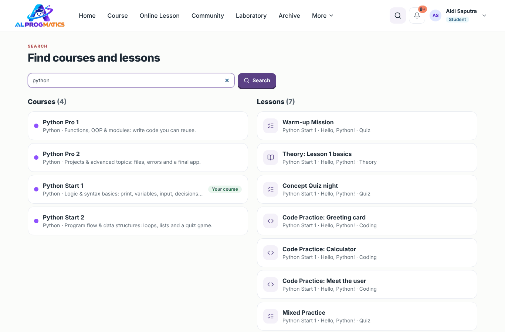
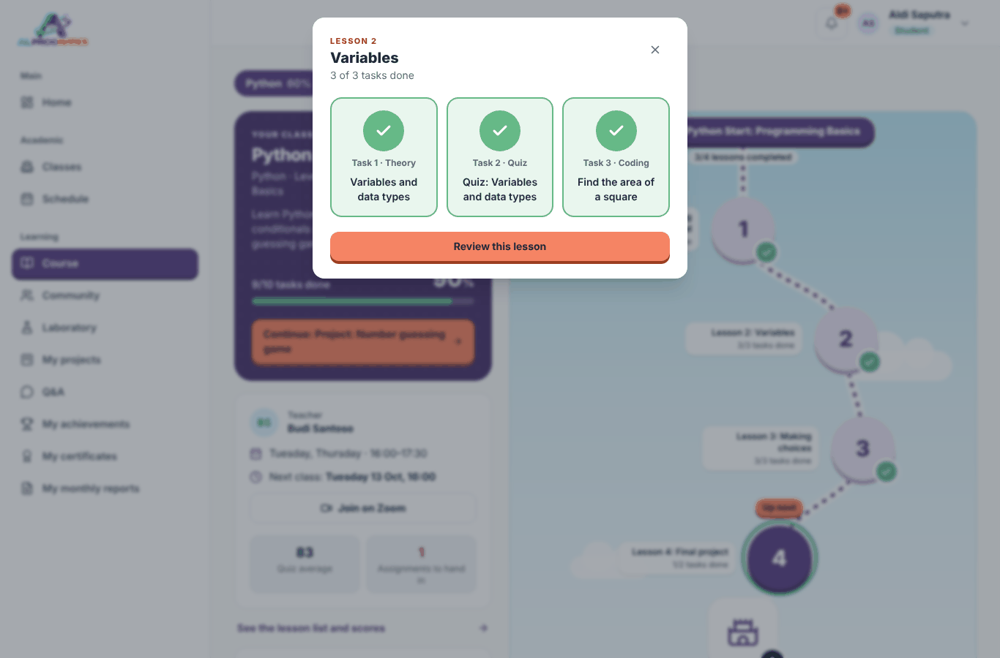
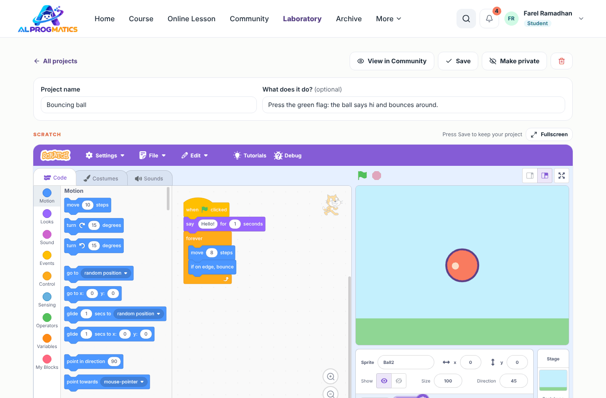
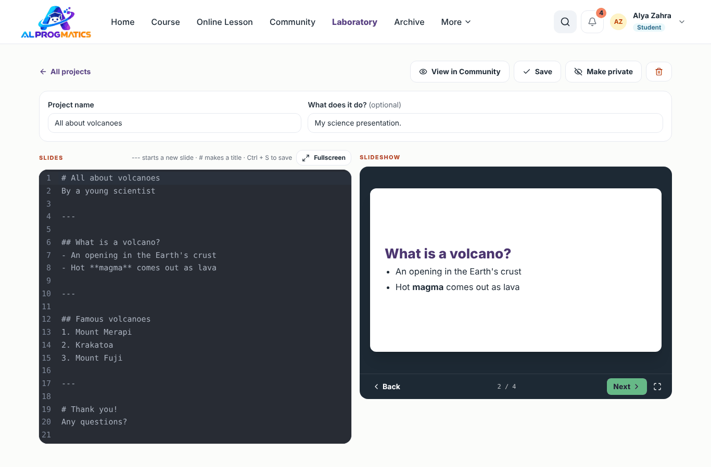
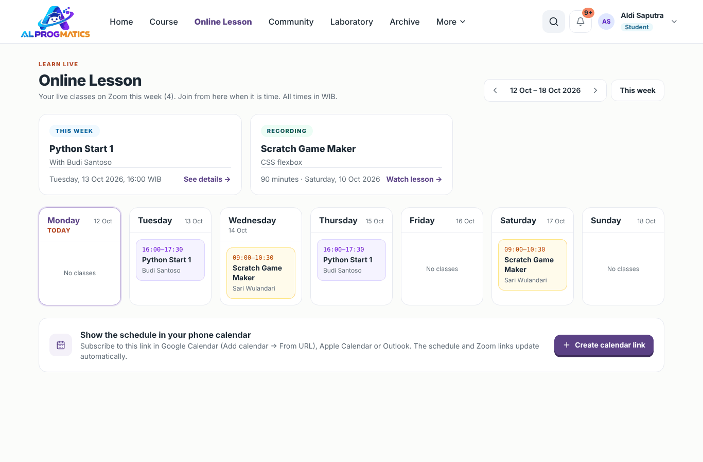

# Panduan Siswa

Halo! Di aplikasi ini kamu bisa melihat jadwal kelas, masuk Zoom, belajar lewat peta kursus, mengerjakan kuis dan soal coding, mengumpulkan tugas, membuat proyek, bereksperimen di Laboratorium, memamerkan karya di Komunitas, bertanya ke guru, dan mengumpulkan XP serta lencana.

Akunmu dibuat oleh admin. Masuk dengan **username** dan kata sandi yang diberikan. Kalau lupa kata sandi, minta tolong orang tua menghubungi admin. Panduan umum (login, notifikasi, kalender) ada di [sini](README.md#hal-yang-sama-untuk-semua-peran).

Tampilan aplikasi memakai bahasa Inggris. Di panduan ini, nama menu dan tombol ditulis **tebal** persis seperti yang kamu lihat di layar.

## Menu siswa

Menu siswa ada di bar atas, sama seperti rancangan klien: **Home**, **Course**, **Online Lesson**, **Community**, **Laboratory**, dan **Archive**. Menu lain (**My projects**, **Q&A**, **My achievements**, **My certificates**, **My monthly reports**) ada di **More**. Di HP, semua menu dibuka lewat tombol ☰ di kanan atas.

**Mencari.** Klik ikon kaca pembesar di kanan atas, ketik minimal 2 huruf (mis. `loop` atau `Python`), lalu tekan Enter. Hasilnya dibagi dua: **Courses** (semua kursus di katalog; kursusmu diberi label **Your course**) dan **Lessons** (hanya pelajaran di level yang sudah boleh kamu buka).

| Menu | Isinya | Alamat |
|---|---|---|
| **Home** | Ringkasan belajarmu hari ini | `/dashboard` |
| **Online Lesson** | Kelas yang sedang berlangsung, kelas berikutnya, rekaman terakhir, dan jadwal minggu ini | `/schedule` |
| **Course** | Peta belajar kursusmu dan katalog kursus lain | `/courses`, `/courses/explore` |
| **Community** | Proyek yang dibagikan siswa lain | `/community` |
| **Laboratory** | Tempat bebas membuat proyek Python, Scratch, presentasi, website, JavaScript | `/lab` |
| **My projects** | Papan proyek dari guru | `/projects` |
| **Q&A** | Tanya jawab dengan guru dan teman | `/questions` |
| **My achievements** | XP, level, dan lencana | `/achievements` |
| **My certificates** | Sertifikat yang sudah kamu dapat | `/my-certificates` |
| **My monthly reports** | Laporan belajar per bulan | `/monthly-reports` |
| **Archive** | Lesson dan level yang sudah selesai, untuk diulang | `/archive` |

## Beranda

Di **Home** kamu melihat:

- Sapaan, jumlah kelas, sesi yang sudah kamu hadiri, dan persentase kehadiran.
- **Level** dan XP-mu, serta **Badges** (lencana) yang sudah kamu dapat.
- **Keep learning**: setiap kursus beserta persentase selesai, rata-rata kuis, dan pelajaran yang perlu kamu kerjakan berikutnya. Klik **All courses** untuk membuka halaman **Course**.
- **My projects**: proyek yang sedang kamu kerjakan. Klik **All projects** untuk melihat semuanya.
- **Next sessions** dengan tombol **Join Zoom**. Klik saat kelas akan dimulai. **My schedule** membuka jadwal lengkap.
- **Last session**: status hadirmu, materi, dan PR (**Homework**) dari guru.
- **Learning quota**: sisa sesi di paketmu.
- **My classes**: kartu setiap kelas yang kamu ikuti.

## Course: peta belajar

Buka **Course**. Browser langsung masuk **layar penuh** supaya peta memenuhi layar; tekan Esc atau tombol layar penuh di kanan atas untuk keluar (aplikasi tidak memaksa layar penuh lagi sampai kamu memulai task). Kursus disusun seperti di sekolah musik: **program** (mis. Python) terdiri dari beberapa **level** (Python Start 1, Python Start 2, …), setiap level berisi **Lesson** bernomor, dan setiap Lesson berisi beberapa **task** (teori, kuis, tugas, coding).

- Halaman peta memenuhi layar seperti dunia bergambar: langit biru, jalur titik-titik, lingkaran Lesson besar, dan kastel di akhir setiap level, tanpa menu samping. Kartu **Your class** di atas peta merangkum kelas, progres, guru, jadwal berikutnya, **Join Zoom**, dan tombol **Continue**.
- Bar atas sama dengan halaman lain (menu **Home**, **Course**, **Online Lesson**, …, pencarian, lonceng notifikasi), ditambah tombol layar penuh. **Explore other courses** di bawah peta membuka katalog.
- Tombol di bawahnya memilih program (mis. **Python**, **Scratch**) lengkap dengan persentase selesai.
- Kartu **Your class** juga menampilkan program dan level (mis. **Python · Level 1**) dan berapa task sudah selesai. Tombol oranye **Start** / **Continue** langsung membawamu ke task berikutnya, dan **Lesson list and scores** membuka daftar nilai.
- Di bawahnya ada peta yang berkelok dari **START · nama level** di atas sampai kastel di bawah. Tulisan di bawah START menunjukkan berapa Lesson sudah selesai (mis. **3/4 lessons completed**).
  - Setiap lingkaran bernomor adalah satu Lesson. Di bawahnya tertulis nomor dan judul Lesson; angka kecil di lingkaran yang menyala menunjukkan task yang sudah selesai.
  - Lingkaran dengan centang hijau sudah selesai. Lingkaran yang menyala dengan label **Up next** (atau **Start here**) adalah yang harus kamu kerjakan sekarang.
  - Klik lingkaran Lesson untuk membuka daftar task-nya, lalu klik task atau tombol **Start lesson** / **Continue**.
  - Lesson dibuka **berurutan**: lingkaran abu-abu bergembok baru terbuka setelah semua task di Lesson sebelumnya selesai. Gurumu bisa membuka Lesson lebih awal untuk seluruh kelas.

**Naik level step by step.** Kastel di ujung peta menunjukkan level berikutnya (**Next: …**). Level itu terkunci (ikon gembok) sampai semua task di level sekarang selesai, lalu terbuka sendiri dan petanya muncul di bawah. Kamu tidak perlu pindah kelas. Level yang masih terkunci tampil sebagai kartu abu-abu **Locked**. Bila guru membuka Lesson tertentu di level berikutnya, level itu muncul dengan hanya Lesson tersebut yang bisa dibuka.

Beberapa kursus lama belum dibagi menjadi Lesson; di sana setiap lingkaran adalah satu task.

Klik **See the lesson list and scores** untuk melihat daftar pelajaran dalam bentuk tabel. Kartu **Explore other courses** di bawahnya membuka katalog kursus.

### Daftar pelajaran dan nilai

Halaman ini menampilkan **Your progress** (persentase dan rata-rata kuis), lalu **Course content**: semua pelajaran berurutan dengan jenis, durasi, dan **Best score**. Kartu **Continue learning** di kanan membawamu ke pelajaran berikutnya. Klik **My course** di kiri atas untuk kembali ke peta.

### Jelajahi kursus lain

Ingin tahu kursus apa lagi yang bisa kamu pelajari? Klik **Explore other courses** di halaman Course (alamatnya `/courses/explore`).

- Panel **Selected course** di kiri menampilkan kursusmu sekarang dan progresnya. **Continue course** membawamu kembali ke peta belajar (langsung layar penuh).
- Di kanan ada satu kartu per program (Data, Artificial Intelligence, Python, Scratch, Computer & Networks, Web Development, Desktop Applications, Android, Internet of Things) dengan kategori, jumlah level, dan jumlah lesson. Program yang sedang kamu ikuti diberi label **Your course**.
- Klik kartu program untuk melihat levelnya secara berurutan. Level milikmu menampilkan persentase selesai; level berikutnya yang belum terbuka diberi label **Locked** dengan keterangan **Finish … to unlock**; level yang sudah kamu tandai diberi label **Interested**. **Course catalog** di atas kembali ke daftar program.
- Klik kursus lain untuk melihat isinya: deskripsi, jumlah pelajaran, dan daftar **What you will learn**. Pelajarannya masih terkunci (ikon gembok) sampai kamu masuk kelas yang memakai kursus itu.

Tertarik? Klik **I'm interested**. Guru, admin, dan orang tuamu akan diberi tahu, lalu mereka bisa membantumu masuk kelasnya. Setelah itu kartunya berubah menjadi **We got your message**, dan di katalog kursus itu diberi label **Interested**.

## Belajar materi, kuis, dan tugas

Saat kamu membuka pelajaran, aplikasi masuk ke **mode fokus**: menu samping dan header disembunyikan supaya kamu bisa berkonsentrasi. Kalau kamu memulai dari peta (klik Lesson, task, **Start lesson**, **Continue**, atau tombol oranye **Continue: …**), browser langsung masuk **layar penuh** dan tetap layar penuh saat kamu pindah task. Tekan Esc atau tombol layar penuh di bar atas untuk keluar.

- Bar gelap di atas berisi tombol panah kiri (**Back to the course map**) untuk kembali ke peta belajar, nama kursus, Lesson yang sedang dibuka (mis. **Lesson 2: Variables**), dan posisi task (mis. **Task 2 of 3**).
- Di tengah bar ada satu lingkaran untuk setiap task di Lesson itu. Lingkaran hijau bercentang sudah selesai, lingkaran putih adalah pelajaran yang sedang dibuka. Klik lingkaran mana pun untuk pindah pelajaran.
- Tombol panah empat arah di kanan bar membuat halaman memenuhi layar (**Fullscreen**). Tekan lagi atau tombol Esc untuk keluar.
- Gunakan **Previous** dan **Next** di bagian bawah untuk pindah ke pelajaran sebelum atau sesudahnya.

### Materi

Baca materinya dan tonton videonya (bila ada). Setelah selesai, klik **Mark as done**. Tulisan berubah menjadi **Done** dan progresmu tersimpan.

### Kuis

Ada empat jenis soal. Petunjuk kecil di bawah setiap soal memberi tahu cara menjawabnya:

| Jenis soal | Petunjuk di layar | Cara menjawab |
|---|---|---|
| Pilihan ganda | **Choose one answer** | Pilih satu jawaban. |
| Banyak jawaban | **Choose all correct answers** | Centang semua jawaban yang benar. |
| Benar/salah | **Choose true or false** | Klik kotak besar **True** (centang hijau) atau **False** (silang merah). |
| Isian singkat | **Type your answer** | Ketik jawabanmu di kotak **Your answer**. Huruf besar/kecil, spasi berlebih, dan titik di akhir tidak berpengaruh. |

1. Jawab pertanyaannya. Di bagian bawah terlihat **Answered** (berapa soal sudah dijawab) dan sisa kesempatan.
2. Klik **Submit answers**. Nilaimu langsung keluar.
3. Kalau belum mencapai nilai lulus, klik **Try again** selama kesempatannya masih ada (**Attempts left**). Sudah lulus pun boleh mencoba lagi dengan **Take it again**.
4. Untuk isian singkat, hasil menampilkan jawabanmu dan jawaban yang diterima (**Accepted**).
5. Kunci jawaban dan pembahasan (**Explanation**) muncul setelah kamu lulus.

**Kuis berwaktu.** Beberapa kuis punya batas waktu. Kamu akan melihat tulisan *This quiz has a ...-minute timer* dan tombol **Start quiz**. Waktu mulai berjalan saat kamu menekan tombol itu, dan **tetap berjalan walaupun kamu meninggalkan halaman**. Jam hitung mundur terlihat di bagian bawah dan berubah kuning lalu merah saat waktunya hampir habis. Kalau waktu habis, jawabanmu terkirim otomatis. Jawaban yang terkirim setelah batas waktu tidak dihitung lulus.

**Warm-up Mission** adalah kuis di awal kursus, bukan ujian. Jawab sebisamu; hasilnya membantu guru tahu harus mulai dari mana. **Final Mission** di akhir kursus menunjukkan seberapa jauh kemajuanmu dibanding misi pemanasan.

### Tugas

1. Isi **Answer / notes**: tulis jawaban atau ceritakan apa yang kamu buat (boleh tempel kode).
2. Tempel **Project link** (mis. dari Replit atau Google Drive) dan/atau isi **Upload a file** (gambar, PDF, ZIP, .sb3, .py, .html; maks. 20 MB).
3. Klik **Submit**. Statusnya menjadi **Awaiting grade**. Selama belum dinilai, kamu masih bisa mengubahnya dengan **Update submission**.
4. Kalau statusnya **Needs revision**, baca catatan guru, perbaiki, lalu kirim lagi lewat form **Resubmit**.
5. Setelah dinilai, statusnya **Graded** dan nilai serta komentar guru muncul.

**Tugas Scratch.** Kalau gurumu mengatur tugas dikerjakan di Scratch, halaman tugas menampilkan editor Scratch (**Build it in Scratch**) langsung di bawah petunjuk. Buat proyekmu di sana, tulis catatan bila perlu, lalu klik **Submit**: proyek Scratch-mu terlampir otomatis. Proyek baru tersimpan saat kamu menekan **Submit**, jadi jangan tutup halaman sebelum mengirim. Selama belum dinilai, **Update submission** membuka proyekmu lagi untuk diperbaiki. Guru bisa memutar proyekmu dengan bendera hijau.

### Melaporkan masalah

Kalau soal, tes, atau materi sepertinya salah, klik **Report a problem** di bawah pelajaran (ada juga di soal coding).

1. Pilih alasannya di **What is wrong?**: jawaban atau tes sepertinya salah, instruksinya tidak jelas, ada yang rusak atau salah ketik, atau alasan lain.
2. Ceritakan lebih lanjut di **Tell us more (optional)**, mis. "Tes 2 mengharapkan 10, padahal 3 + 4 = 7".
3. Klik **Send report**. Guru mendapat notifikasi, dan di pelajaran itu tertulis *You reported a problem. Your teacher will check it.*

Setelah guru memeriksa, kamu mendapat notifikasi: **Fixed** kalau pelajarannya sudah diperbaiki, atau **Checked** kalau ternyata pelajarannya sudah benar.

## Soal coding

Kode kamu dijalankan langsung di browser, jadi tidak perlu memasang apa pun.

1. Baca cerita soal dan **Sample tests**. Ikon gembok memberi tahu berapa tes tersembunyi yang ikut dinilai saat kamu mengumpulkan.
2. Tulis kode di editor. Tekan **Run sample tests** (atau Ctrl+Enter) untuk mencoba. Buka **Try your own input** bila ingin menguji input lain (satu nilai per baris).
3. Kalau sudah yakin, klik **Submit**. Server menilai kodemu dengan tes contoh dan tes tersembunyi. Hasilnya muncul di bagian atas, mis. **All tests passed!** atau **So close! Try again**.
4. Bingung? Klik **Show hint 1** di kotak **Hints**. Petunjuk terbuka satu per satu. Setelah beberapa kali mencoba, kotak **See solution** bisa muncul.
5. **Your history** menyimpan kiriman sebelumnya. Tombol panah melingkar di samping **Submit** mengembalikan kode awal.
6. Tombol panah empat arah di sebelahnya (**Fullscreen**) membuat soal dan editor memenuhi layar, dengan editor yang lebih tinggi. Klik **Exit fullscreen** atau tekan Esc untuk kembali.

Saat pertama kali membuka soal Python, tunggu sebentar: browser sedang menyiapkan Python (hanya lama di awal).

**Aturan kode.** Beberapa soal punya kotak **Code rules**, misalnya kode harus memakai `for`, tidak boleh memakai `sum`, atau paling banyak 6 baris. Aturan ini dicek saat kamu menekan **Submit** (*Checked when you submit*). Komentar dan isi teks di dalam tanda kutip tidak dihitung, jadi menulis kata kuncinya di komentar tidak akan lolos.

Jenis soal lain:

- **HTML/CSS**: hasil halamanmu tampil di **Preview**. Klik **Check my page** untuk mencoba. Kotak **What gets checked** berisi hal-hal yang dinilai.

  

- **Susun baris**: seret baris kode (atau pakai tombol panah atas/bawah) sampai urutannya benar, lalu klik **Submit**. Baris merah berarti belum di posisi yang benar.

## Laboratory

**Laboratory** (`/lab`) adalah tempat bebas untuk mencoba ide. Tidak ada nilai di sini.

1. Klik **New project**. Di jendela **What do you want to make?**, pilih jenisnya: **Python**, **Scratch** (game dan cerita dengan balok), **Presentation** (slide), **Website** (HTML, CSS, dan JS), atau **JavaScript**.
2. Isi **Project name**, lalu klik **Create and open**.
3. Tulis kode di editor. Klik **Run** (atau Ctrl+Enter) untuk menjalankannya. Hasilnya muncul di **Output**; untuk website, halamanmu tampil di **Preview**. Kalau programmu meminta input, klik **Input** dan tulis satu nilai per baris.
4. Isi **What does it do?** supaya orang lain tahu proyekmu tentang apa.
5. Klik **Save** (atau Ctrl+S). Tulisan **Unsaved changes** berarti ada perubahan yang belum tersimpan.
6. Klik **Fullscreen** di atas editor supaya editor dan panel hasil memenuhi layar. Klik **Exit fullscreen** atau tekan Esc untuk kembali.

**Proyek Scratch.** Editor Scratch lengkap terbuka di halaman proyek (kode balok, kostum, suara, panggung). Klik **Save** untuk menyimpan proyek ke akunmu; tulisan **Unsaved changes** muncul setiap kali kamu mengubah sesuatu. **Fullscreen** membuat editor memenuhi layar dan tetap punya tombol **Save**. Menu **File** milik Scratch tetap bisa dipakai untuk memuat atau mengunduh berkas `.sb3`.

**Presentation.** Tulis slide di kiri: baris berisi tiga tanda minus (`---`) memisahkan slide, `#` membuat judul besar, `##` judul kecil, `-` daftar berbutir, `**tebal**`. Slideshow di kanan langsung berubah saat kamu mengetik. Pakai **Back** / **Next** (atau tombol panah di keyboard) dan ikon layar penuh untuk presentasi.

Di daftar proyek, gunakan tombol **All**, **Python**, **Scratch**, **Presentation**, **Website**, dan **JavaScript** untuk menyaring. Klik **All projects** di editor untuk kembali ke daftar. Ikon tempat sampah menghapus proyek.

**Membagikan ke Komunitas.** Klik **Save & share** di editor. Proyekmu muncul di Komunitas dan kartunya diberi label **In Community**. Mau menariknya lagi? Klik **Make private**. **View in Community** membuka halaman proyekmu di Komunitas.

## Community

**Community** (`/community`) berisi proyek yang dibagikan siswa dari semua kelas.

- **Trending**: proyek yang paling banyak disukai **Today** (hari ini), **Week** (7 hari), atau **Month** (30 hari). Pilih periodenya di kanan.
- Urutkan dengan **New**, **Popular**, atau **Most discussed**. Saring dengan **All**, **Python**, **Scratch**, **Presentation**, **Website**, **JavaScript**, atau cari lewat **Search projects**.
- **Share a project** membawamu ke Laboratory untuk memilih proyek yang mau dibagikan.

Klik kartu untuk membuka proyek. Di sana kamu bisa:

- Menjalankan proyeknya dengan **Run**, dan membuka **Code** untuk melihat kodenya. Proyek Scratch diputar dengan **bendera hijau** (ikon kotak di kanan atas untuk layar penuh); presentasi diputar dengan **Back** / **Next**.
- Menekan ikon hati untuk menyukai proyek (tekan lagi untuk membatalkan).
- Menulis komentar di **Comments**, lalu klik **Post comment**. Tulis yang baik, atau tanyakan cara kerjanya. Kamu bisa menghapus komentarmu sendiri, dan pemilik proyek bisa menghapus komentar di proyeknya.
- Kalau itu proyekmu, klik **Edit in Laboratory** untuk mengubahnya.

Guru bisa menurunkan proyek dari Komunitas. Kalau itu terjadi, kartunya berlabel **Removed by teacher**; kamu tetap bisa mengerjakannya di Laboratory, tetapi tidak bisa membagikannya lagi.

## My projects

Guru membuat proyek, dan kamu mendapat papan sendiri dengan kolom: **To do → Doing → Ready for review → Done**. Kolom **Ready for review** hanya ada kalau langkah proyek perlu dicek guru.

1. Buka **My projects**, pilih proyek. Baca **Teacher's project instructions** bila ada.
2. Seret kartu ke **Doing** saat kamu mulai mengerjakannya. Di HP, pakai tombol panah kiri/kanan pada kartu.
3. Kalau langkahnya sudah selesai, geser ke **Ready for review**. Guru akan menyetujuinya (kartu pindah ke **Done**) atau mengembalikannya dengan catatan (**Teacher's note**).
4. Kamu boleh menambah langkah sendiri dengan **Add card**. Kartu bertopi wisuda adalah langkah dari guru.
5. Di bagian **Project result**, isi **Project link** (Scratch, Replit, GitHub Pages) dan **A short story**, lalu klik **Save**.

Kalau semua langkah sudah di **Done**, muncul ucapan **Project complete!** Kalau proyek sudah diarsipkan guru, papannya tidak bisa diubah lagi. Klik **All projects** untuk kembali ke daftar.

## Q&A

Tidak ada pertanyaan yang bodoh! Teman sekelasmu mungkin juga bingung hal yang sama.

Di daftar pertanyaan, pakai tab **All**, **Unanswered**, **Has answers**, **Resolved**, dan **My questions**, pilih kelas di **All classes**, atau cari lewat **Search questions...**.

1. Buka **Q&A → Ask a question**, atau klik **Ask** di kartu **Stuck? Ask your teacher** di halaman pelajaran.
2. Pilih **Class** dan (opsional) pelajarannya di **About a lesson**. Pilih **General question** kalau tidak tentang pelajaran tertentu.
3. Tulis **Question title** yang singkat, ceritakan apa yang sudah kamu coba di **Tell us more**, klik **Add code** untuk menempel kode, dan lampirkan tangkapan layar di **Image (optional)** bila perlu (JPG/PNG, maks. 4 MB).
4. Atur **Who can see it?**: **Whole class** (teman sekelas bisa membaca dan ikut menjawab) atau **Teacher only**. Centang **Hide my name from classmates** kalau malu; teman akan melihat "A classmate", tetapi guru dan orang tuamu tetap tahu.
5. Klik **Send question**. Kamu mendapat notifikasi saat ada jawaban.

Kartu **Stuck? Ask your teacher** di setiap halaman pelajaran juga menampilkan pertanyaan teman tentang pelajaran itu. Klik **View** untuk melihat semuanya:

Setelah paham, klik **Pick as best answer** pada jawaban yang paling membantu; pertanyaanmu ditandai **Resolved**. Masih bingung? Klik **Reopen**. Kamu juga bisa menekan **Me too** pada pertanyaan teman dan **Helpful** pada jawaban yang bagus, serta ikut menjawab pertanyaan teman di kotak **Help answer** lalu klik **Send answer**.

## My achievements

Kamu mendapat **XP** otomatis dari kegiatan belajar:

| Kegiatan (seperti di layar) | XP |
|---|---|
| **Finished a lesson** | 10 |
| **Passed a quiz** | 20 |
| **Scored 100 on a quiz** | +10 |
| **Assignment graded** | 25 |
| **Passed a coding exercise** | 25 |
| **Attended class** | 15 |
| **Asked in Q&A** | 5 |
| **Answer picked as best** | 20 |
| **Finished a project step** | 10 |
| **Finished a project** | 50 |
| **Shared a project** (ke Community) | 15 |
| **Got a like on a project** (sekali per proyek) | 5 |
| **Commented on a classmate's project** | 2 |
| **Earned a certificate** | 100 |

XP menaikkan **level**: **Code Rookie**, **Explorer**, **Tinkerer**, **Inventor**, **Junior Engineer**, **Creator**, **Code Master**, sampai **Legend**. Ada juga **19 lencana**. Enam di antaranya sama dengan rancangan klien: **First project** (bagikan 1 proyek), **3 projects** (bagikan 3 proyek), **First like** (proyekmu disukai teman), **First comment** (komentari proyek teman), **Python starter** (selesaikan 1 pelajaran Python), dan **10 questions solved** (lulus 10 kuis atau soal coding). Lainnya misalnya **First Steps** (1 pelajaran), **Little Coder** (1 soal coding), **Always There** (hadir 8 sesi), **Brave Asker** (1 pertanyaan), **Builder** (1 proyek), dan **Graduate** (1 sertifikat). Lencana yang belum didapat tampil pudar beserta progresnya.

Halaman **My achievements** juga menampilkan **Class stars this month** (5 siswa dengan XP terbanyak bulan ini di setiap kelasmu), **Latest XP**, dan **How to earn XP**.

## My certificates

Setelah kamu menyelesaikan semua pelajaran di kursus, guru akan menerbitkan sertifikat. Buka **My certificates**, pilih sertifikat, lalu klik **Print / save as PDF**. Sertifikat punya kode QR yang bisa dipindai untuk membuktikan keasliannya; tombol **Copy verification link** menyalin tautan pemeriksaannya.

## My monthly reports

**My monthly reports** (`/monthly-reports`) berisi laporan belajarmu setiap bulan, sama seperti yang dibaca orang tuamu.

1. Pilih bulan di kotak di kanan atas, lalu klik **Open report**.
2. Laporan berisi **Attendance**, **Lessons completed**, **Quiz average**, **XP this month**, catatan guru (**Going well** dan **Focus for next month**), daftar sesi bulan itu beserta PR, nilai kuis dan tugas, latihan coding dan proyek, lencana bulan itu, dan progres kursus, serta sisa sesi paket. Jumlah tagihan hanya tampil untuk orang tua dan admin.
3. Pakai tombol panah di samping nama bulan untuk pindah bulan, dan **Print / save PDF** untuk mencetak.

## Archive

**Archive** (`/archive`) menyimpan semua Lesson yang sudah kamu selesaikan, dikelompokkan per level. Klik sebuah Lesson untuk mengulangnya kapan saja. Level yang sudah tuntas diberi tanda **Level complete**.

## Jadwal dan notifikasi

- **Online Lesson** menampilkan kartu seperti rancangan klien: **Live now** (kelas yang sedang berlangsung atau mulai dalam 10 menit, dengan tombol **Join on Zoom**), **This week** / **Coming up** (kelas berikutnya), dan **Recording** (rekaman Zoom kelas terakhir, tombol **Watch lesson**). Di bawahnya ada jadwal kelas Zoom-mu minggu ini. Kamu bisa memasangnya ke kalender HP lewat **Create calendar link** (lihat [panduan umum](README.md#jadwal-di-kalender-hp)).
- Kelasmu (guru, jadwal, sesi berikutnya, **Join Zoom**) tampil di kartu **Your class** di halaman **Course**.
- **Lonceng** memberi tahu PR baru dari sesi, tugas yang sudah dinilai atau perlu revisi, jawaban atas pertanyaanmu, dan hasil pemeriksaan laporan masalah yang kamu kirim.
